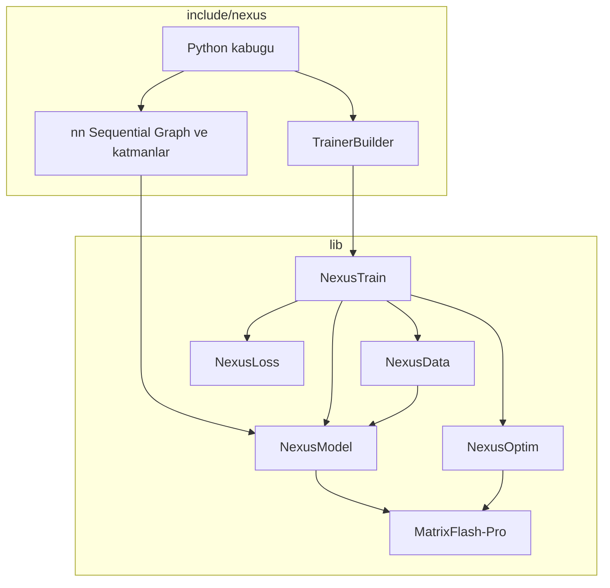

# Nexus

Bu yazılım ekosistemi Bursa Teknik Üniversitesi Bilgisayar Mühendisliği 1. sınıf öğrencisi Muhammed Fatih Şahin tarafından yapay zeka destekli olarak geliştirilmiştir.

C++20 derin öğrenme ve pekiştirmeli öğrenme çerçevesi. Altı kütüphane tek statik hedefte toplanır: `nexus::nexus`. Python kabuğu aynı çağrı adlarını kullanır. PyTorch taklidi yoktur.

[](https://en.cppreference.com/w/cpp/20)
[](CMakeLists.txt)
[](LICENSE)
[](python/README.md)

Dokümantasyon sitesi bu deponun `web/` klasöründedir. `npm install` ve `npm run build` ile derlenir.

## İç mimari

Eğitim döngüsü soldan sağa akar. Hesap, alttaki kütüphanelerde durur. `include/nexus` bu kütüphanelerin üstüne ince bir çağrı yüzeyi koyar.



Bir adım şöyle biter:

1. **NexusData** batch'i host bellekte hazırlar. Sayısal CSV ve görüntü buradan gelir.
2. **NexusModel** `forward` çalıştırır. Linear ve dikkat, **MatrixFlash-Pro** GEMM'ine iner.
3. **NexusLoss** logit ile hedefi karşılaştırır ve gradyanı çağıranın tamponuna yazar.
4. **NexusModel** `backward` ağırlık gradyanını biriktirir.
5. **NexusOptim** gradyanı parametreye uygular.
6. **NexusTrain** epok, erken duruş, zamanlayıcı ve kayıp ölçeğini sıraya dizer.

`nexus` statik kütüphanesi üç çeviri birimini kendisi derler: `src/core/memory.cpp`, `src/core/mirrored_tensor.cpp`, `src/model/nxs.cpp`. Geri kalan API başlıktadır ve `PUBLIC` bağımlılıklarla gelir.

## Kütüphaneler

| Kütüphane | CMake hedefi | Depo | Bağlandığı yer |
| --- | --- | --- | --- |
| MatrixFlash-Pro | `matrix_pro` | [MatrixFlash_Pro](https://github.com/muhamedsahin/MatrixFlash_Pro) | `nexus::nexus` her derlemede. GEMM, kolektif, CUDA conv |
| NexusData | `nexusdata` | [NexusData](https://github.com/muhamedsahin/NexusData) | Eğitmenin batch kaynağı. Model tensörüne kopyalanır |
| NexusLoss | `nexusloss` | [NexusLoss](https://github.com/muhamedsahin/NexusLoss) | `Trainer` içindeki CrossEntropy ve MSE |
| NexusOptim | `nexus_optim` | [NexusOptim](https://github.com/muhamedsahin/NexusOptim) | `AdamW` ve `SGD` adımı. Çekirdekte daha geniş bir optimizer listesi durur |
| NexusModel | `nexus_model` | [NexusModel](https://github.com/muhamedsahin/NexusModel) | `nn::` katmanları. MatrixFlash GEMM'ini çağırır |
| NexusTrain | `nexus_train` | Bu deponun `lib/NexusTrain` yolu | Epok döngüsü, callback, kayıp ölçeği |

Beş kütüphane Git alt modülüdür. NexusTrain'in ayrı uzak deposu yoktur; kaynak bu ağacın içindedir.

```cmake
target_link_libraries(my_app PRIVATE nexus::nexus)
```

`matrix_pro` CUDA açıkken `CUDA::cudart` ile birlikte bağlanır. `MATRIX_PRO_ENABLE_CUDNN` kök CMake'de kapalıdır.

## Kurulum

Windows, Visual Studio 2022, CMake 3.24 ve Ninja. CUDA 13.4 isteğe bağlıdır. PATH üzerindeki `cmake` ESP-IDF olabilir; tam yolu kullanın.

```bat
call "C:\Program Files\Microsoft Visual Studio\2022\Preview\VC\Auxiliary\Build\vcvars64.bat"
"C:\Program Files\CMake\bin\cmake.exe" -S . -B build-phase1 -G Ninja -DCMAKE_BUILD_TYPE=Release
"C:\Program Files\CMake\bin\cmake.exe" --build build-phase1 --parallel
"C:\Program Files\CMake\bin\cmake.exe" -E chdir build-phase1 ctest --output-on-failure -C Release
```

Anahtarlar `cmake/NexusOptions.cmake` içindedir: `NEXUS_ENABLE_CUDA`, `NEXUS_BUILD_TESTS`, `NEXUS_BUILD_BENCHMARKS`, `NEXUS_BUILD_PYTHON`.

Alt modüller ilk klonda boş kalırsa:

```bat
git clone --recurse-submodules https://github.com/muhamedsahin/Nexus.git
```

## Python

Anaconda 3.11. ESP-IDF Python 3.14 kullanılmaz.

```bat
"C:\Program Files\CMake\bin\cmake.exe" -S . -B build-phase1 -DNEXUS_BUILD_PYTHON=ON -DPython3_EXECUTABLE=C:\ProgramData\anaconda3\python.exe
"C:\Program Files\CMake\bin\cmake.exe" --build build-phase1 --target _core --parallel
set PYTHONPATH=python\src
```

Modül `python/src/nexus/_core.cp311-win_amd64.pyd` olur. Ayrıntı [python/README.md](python/README.md).

## Eğitim

```cpp
#include <nexus/nexus.hpp>

auto model = nexus::nn::Sequential()
    .add<nexus::nn::Linear>(16, 32)
    .add(nexus::nn::swish())
    .add<nexus::nn::Linear>(32, 3);

auto trainer = nexus::TrainerBuilder(model)
    .optimizer(nexus::optim::AdamW(model->parameters(), {.lr = 0.05f}))
    .loss(nexus::loss::CrossEntropy(0.0f))
    .execution_policy(nexus::ExecutionPolicy::cpu())
    .gradient_clip_norm(1.0f)
    .metric<nexus::metrics::Accuracy>()
    .callback<nexus::callbacks::EarlyStopping>(5)
    .build();

trainer.fit(train_loader, val_loader, 12);
model.save_nxs("ag.nxs");
```

`mixed_precision(true)` kayıp ölçeği uygular. Matmul FP32 kalır. Sonlu olmayan gradyanda adım atlanır.

## Graf ve dil modeli

`Sequential` tek tensörlük bir hattır. Bir katman hem 4. hem 2. katmanın tensörünü okuyacaksa `Graph` kurulur. İki giriş `Add` ile toplanır veya `Concat` ile son eksende yan yana gelir. `Residual` yalnızca kendi bloğunun girişini çıkışına ekler. Grafın yerine geçmez.

Dil modeli iskeleti `CausalTransformerBlock` ve `LanguageTrainer` ile kurulur. Blok tek tensör alır. Dikkat nedenseldir. `TransformerEncoderLayer` nedensel değildir ve öyle kalır. Kayıp, logitlerin `[:, :-1]` dilimi ile tokenların `[:, 1:]` dilimi arasındaki çapraz entropidir. `Trainer` düz satır sınıflandırması olarak durur.

RoPE, uzman karışımı ve KV önbelleği bu turda yoktur. Sinüs konum kodu vardır. Ayrıntı [docs/architecture/graph-and-lm.md](docs/architecture/graph-and-lm.md).

`ExecutionPolicy::hybrid_cpu_multi_gpu()` yalnız açıkça istenirse Linear çarpımını MatrixFlash zamanlayıcısına verir. `ExecutionPolicy::cuda` bugün matmul'u CPU çekirdeğinde bırakır. Aygıt evrişimi ayrı çağrıdır: Python'da `nexus.nn.conv2d_device`.

## Model dosyası

`save_nxs` sihri `NXS2` olan tek dosya yazar. Ağ, ağırlık, isteğe bağlı optimizer ve eğitmen durumu aynı arşivdedir. `NXS1` yalnızca eski eğitmen kaydıdır; model diye açılmaz ve okuyucu `bu egitmen durumu, model arsivi degil` der.

`Swish` C++ formülüdür. Başka bir adlı aktivasyonun gövdesi dosyaya girer. Kapalı hücre yalnız float, int veya bool ise yeni süreçte geri kurulur.

## Pekiştirmeli öğrenme

Tek ajan ortamları `LineWorld`, `GridWorld`, `CartPole`, `PointMass`. Algoritmalar DQN, PPO, SAC, Actor-Critic. Çok ajan `ButtonWorld` ve `TeamButton`. `League` ELO tutar. `VectorEnv` birden fazla ortamı aynı adımda yürütür.

Python'dan türetilen `Environment` ve `Callback` kabul edilir. Gövde C++ sanal işlevine trampoline ile iner.

## Bu makinede ölçülen hız

21 Ekim 2026 akşamı. Ryzen 7 5800H, RTX 3070 Laptop, CPU, iş parçacığı etiketi `"8"`. Ham sayılar `docs/benchmarks/` altındadır. Dünya sıralaması yoktur.

| İş | Nexus | PyTorch | TensorFlow |
| --- | ---: | ---: | ---: |
| GEMM N=2048, GFLOPS | 362 ve 369, sıcak tur 330 | 336 | 389 |
| Conv2d, GFLOPS | 5.43 ve 6.78 | 31.6 | 12.7 |
| Depthwise, GFLOPS | 10.4 ve 12.1 | 4.93 | 0.688 |
| Attention, çağrı/s | 9653 ve 6870 | 1192 | 1076 |
| Adam, GB/s | 28.2 ve 24.8 | 4.71 | 3.23 |

GEMM'de seçili çekirdek `avx2-4x16`. Bu işlemcide AVX-512 seçilmez. Üç GEMM turu da TensorFlow'un 389 değerinin altındadır. Conv2d CPU sütununda PyTorch öndedir.

CUDA conv kapısı Nexus'un kendi CPU conv'una karşıdır. Şekil `8×3×32×32`, 16 filtre, `3×3`, pad 1. CPU 6.39 GFLOPS, aygıtta kalan çekirdek 48.7, host gidiş-dönüş 19.0. Bu satır PyTorch ile karşılaştırılmaz. cuDNN bu kurulumda yoktur.

## Belgeler

| Yol | İçerik |
| --- | --- |
| `web/` | Kurulum, C++, Python, API, benchmark |
| `docs/benchmarks/` | 21 Ekim protokolü ve JSON |
| `docs/architecture/` | Faz notları, graf ve dil modeli |
| `python/README.md` | Kabuk derlemesi ve `.nxs` |

## Lisans

Apache License 2.0. Metin `LICENSE` dosyasındadır.

---

Bu proje Muhammed Fatih Şahin tarafından geliştirilmiştir.

Bu yazılım ekosistemi Bursa Teknik Üniversitesi Bilgisayar Mühendisliği 1. sınıf öğrencisi Muhammed Fatih Şahin tarafından yapay zeka destekli olarak geliştirilmiştir.
