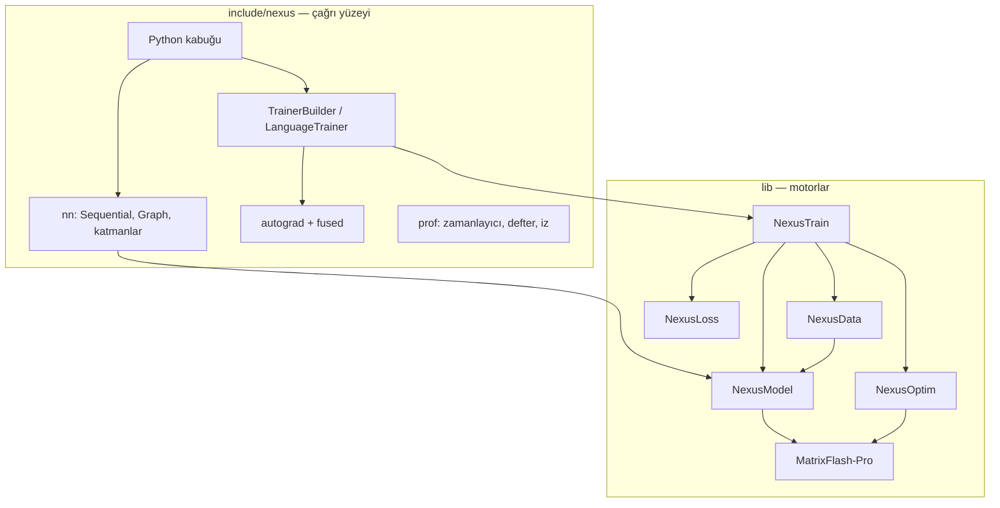

<div align="center">

# ⚡ Nexus

### Küçük tariften büyük modele: C++20 derin öğrenme ve pekiştirmeli öğrenme çerçevesi

*Altı kütüphane, tek statik hedef `nexus::nexus`, aynı adları kullanan bir Python kabuğu.*
*PyTorch taklidi değil; her iddia aynı makinede ölçülmüş ham sayıyla gelir.*

[](https://en.cppreference.com/w/cpp/20)
[](CMakeLists.txt)
[](cmake/NexusOptions.cmake)
[](python/README.md)
[](LICENSE)


[Mimari](#-mimari) •
[Kütüphaneler](#-kütüphaneler) •
[Kurulum](#-kurulum) •
[Hızlı başlangıç](#-hızlı-başlangıç) •
[Ölçümler](#-bu-makinede-ölçülen-hız) •
[Yol haritası](#-yol-haritası) •
[Belgeler](#-belgeler)

</div>

> Bu yazılım ekosistemi Bursa Teknik Üniversitesi Bilgisayar Mühendisliği 1. sınıf öğrencisi Muhammed Fatih Şahin tarafından yapay zeka destekli olarak geliştirilmiştir.

---

## ✨ Öne çıkanlar

<table>
<tr>
<td width="33%" valign="top">

### 🧠 Autograd motoru
Tensör düzeyinde ters-mod türev: `Node`/`Edge`/`AccumulateGrad`, kaydedilmiş tensörde sürüm denetimi, **saved-tensor kancaları** (offload), **anomali modu**, ara tensör kancaları ve `CustomFunction` ile klasik katman köprüsü.

</td>
<td width="33%" valign="top">

### 🔥 Füzyonlu çekirdekler
Tek geçişte **kaydırmalı çapraz entropi** (kopyasız, yerinde, z-loss, label smoothing), RMSNorm, gömme+konum, **Philox dropout** (maske saklanmaz), çok-tensörlü AdamW + global norm kırpma.

</td>
<td width="33%" valign="top">

### 📏 Ölçüm altyapısı
`nexus::prof` zamanlayıcı, FLOP/bayt sayaçları, Chrome izi, etiketli bellek defteri, `nexus_estimate` analitik bellek/FLOP modeli ve **Nexus ↔ PyTorch parity** düzeneği.

</td>
</tr>
<tr>
<td valign="top">

### 🧱 Katman kataloğu
Linear, Conv1/2/3D, Depthwise, Batch/Layer/Group/InstanceNorm, RNN/LSTM/GRU, çok başlı dikkat, `CausalTransformerBlock`, `Graph` (çok girişli, `Add`/`Concat`).

</td>
<td valign="top">

### 🎮 Pekiştirmeli öğrenme
DQN, PPO, SAC, Actor-Critic; `LineWorld`, `GridWorld`, `CartPole`, `PointMass`; çok ajanlı `ButtonWorld`/`TeamButton`, ELO tutan `League`, `VectorEnv`.

</td>
<td valign="top">

### 💾 NXS2 arşivi
Ağ, ağırlık, optimizer ve eğitmen durumu tek dosyada. Tür numaraları sabit (Graph = 31, Concat = 32, CausalBlock = 33); geriye uyum kuralı korunur.

</td>
</tr>
</table>

---

## 🏗 Mimari

Eğitim döngüsü soldan sağa akar. Hesap, alttaki kütüphanelerde durur. `include/nexus` bu kütüphanelerin üstüne ince bir çağrı yüzeyi koyar.



Bir eğitim adımı:

1. **NexusData** batch'i host bellekte hazırlar (CSV, görüntü, metin).
2. **NexusModel** `forward` çalıştırır; Linear ve dikkat **MatrixFlash-Pro** GEMM'ine iner.
3. **NexusLoss** (veya füzyonlu kaydırmalı CE) kaybı ve gradyanı çağıranın tamponuna yazar.
4. **NexusModel** `backward` ağırlık gradyanını biriktirir.
5. **NexusOptim** gradyanı parametreye uygular.
6. **NexusTrain** epok, erken duruş, zamanlayıcı ve kayıp ölçeğini sıraya dizer.

---

## 📦 Kütüphaneler

| | Kütüphane | CMake hedefi | Görev |
| :---: | --- | --- | --- |
| ⚡ | [**MatrixFlash-Pro**](https://github.com/muhamedsahin/MatrixFlash_Pro) | `matrix_pro` | AVX2 GEMM (`avx2-4x16`), cuBLAS/cuBLASLt, CUDA conv, heterojen zamanlayıcı |
| 🧱 | [**NexusModel**](https://github.com/muhamedsahin/NexusModel) | `nexus_model` | Katmanlar, `forward`/`backward`, parametre gradyanları |
| 📂 | [**NexusData**](https://github.com/muhamedsahin/NexusData) | `nexusdata` | Veri kümeleri, görüntü çözme/yeniden boyutlama, tokenizer'lar |
| 📉 | [**NexusLoss**](https://github.com/muhamedsahin/NexusLoss) | `nexusloss` | Kayıp aileleri; eğitmenin çağırdığı CrossEntropy ve MSE |
| 🚀 | [**NexusOptim**](https://github.com/muhamedsahin/NexusOptim) | `nexus_optim` | 14 optimizer, 7 zamanlayıcı, AVX2/AVX-512/CUDA güncelleme çekirdekleri |
| 🔁 | **NexusTrain** | `nexus_train` | Epok döngüsü, callback, kayıp ölçeği (bu ağaçta, `lib/NexusTrain`) |

Beş kütüphane Git alt modülüdür. NexusTrain'in ayrı uzak deposu yoktur.

```cmake
target_link_libraries(my_app PRIVATE nexus::nexus)
```

---

## 🛠 Kurulum

Windows, Visual Studio 2022, CMake 3.24+ ve Ninja. CUDA 13.4 isteğe bağlıdır.
PATH üzerindeki `cmake` ESP-IDF olabilir; **tam yolu** kullanın.

```bat
git clone --recurse-submodules https://github.com/muhamedsahin/Nexus.git
cd Nexus
call "C:\Program Files\Microsoft Visual Studio\2022\Preview\VC\Auxiliary\Build\vcvars64.bat"
"C:\Program Files\CMake\bin\cmake.exe" -S . -B build -G Ninja -DCMAKE_BUILD_TYPE=Release
"C:\Program Files\CMake\bin\cmake.exe" --build build --parallel
"C:\Program Files\CMake\bin\ctest.exe" --test-dir build --output-on-failure -C Release
```

| Anahtar (`cmake/NexusOptions.cmake`) | Ne yapar |
| --- | --- |
| `NEXUS_ENABLE_CUDA` | CUDA yollarını derler (`conv_gate` dahil) |
| `NEXUS_BUILD_TESTS` | Birim, faz ve parity testleri |
| `NEXUS_BUILD_BENCHMARKS` | `benchmarks/` ve `benchmarks/runner` |
| `NEXUS_BUILD_PYTHON` | `_core` Python eklentisi |
| `NEXUS_PARITY_PYTHON` | PyTorch kurulu python (boşsa `.bench-venv` denenir; yoksa parity **SKIPPED**) |

<details>
<summary><b>🐍 Python kabuğu</b></summary>

Anaconda 3.11 kullanılır; ESP-IDF Python 3.14 kullanılmaz.

```bat
"C:\Program Files\CMake\bin\cmake.exe" -S . -B build -DNEXUS_BUILD_PYTHON=ON -DPython3_EXECUTABLE=C:\ProgramData\anaconda3\python.exe
"C:\Program Files\CMake\bin\cmake.exe" --build build --target _core --parallel
set PYTHONPATH=python\src
```

Modül `python/src/nexus/_core.cp311-win_amd64.pyd` olur. Ayrıntı: [python/README.md](python/README.md).

</details>

---

## 🚀 Hızlı başlangıç

**Sınıflandırma eğitimi**

```cpp
#include <nexus/nexus.hpp>

auto model = nexus::nn::Sequential()
    .add<nexus::nn::Linear>(16, 32)
    .add(nexus::nn::swish())
    .add<nexus::nn::Linear>(32, 3);

auto trainer = nexus::TrainerBuilder(model)
    .optimizer(nexus::optim::AdamW(model->parameters(), {.lr = 0.05f}))
    .loss(nexus::loss::CrossEntropy(0.0f))
    .execution_policy(nexus::ExecutionPolicy::cpu())
    .gradient_clip_norm(1.0f)
    .metric<nexus::metrics::Accuracy>()
    .callback<nexus::callbacks::EarlyStopping>(5)
    .build();

trainer.fit(train_loader, val_loader, 12);
model.save_nxs("ag.nxs");
```

**Autograd + füzyonlu op'lar**

```cpp
#include <nexus/autograd/autograd.hpp>
#include <nexus/fused/training.hpp>

namespace ag = nexus::autograd;
auto w = ag::Variable::randn(ag::Shape{{64, 256}}, /*seed=*/1, /*requires_grad=*/true);
auto x = ag::Variable::randn(ag::Shape{{8 * 32, 64}}, 2, false);
std::vector<std::int32_t> tokens(8 * 32, 7);                       // [B*T] token kimlikleri

auto logits = ag::matmul(x, w);                                   // [B*T, V]
auto loss = nexus::fused::cross_entropy_shifted(logits, tokens, /*batch=*/8, /*time=*/32);
loss.backward();                                                  // w.grad() hazır
```

**Dil modeli** — `CausalTransformerBlock` + `LanguageTrainer`. Kayıp, logitlerin `[:, :-1]` dilimi ile
tokenların `[:, 1:]` dilimi arasındaki çapraz entropidir; dilimler kopyalanmaz, füzyonlu CE indeks
ofsetiyle okur. `TransformerEncoderLayer` nedensel değildir ve öyle kalır. Ayrıntı:
[docs/architecture/graph-and-lm.md](docs/architecture/graph-and-lm.md).

> ℹ️ Tam GPU eğitim yolu `nexus::cuda::GptModel` / `GptTrainer`'dır (GPT-2 mimarisi; parametre, gradyan, AdamW durumu,
> aktivasyon ve logit kartta). Genel `nn::Sequential` için `ExecutionPolicy::cuda` hâlâ matmul'u CPU çekirdeğinde bırakır.
> `mixed_precision(true)` yalnız kayıp ölçeği uygular; matmul FP32 kalır (BF16/FP16 autocast FAZ 4).

---

## 📊 Bu makinede ölçülen hız

AMD Ryzen 7 5800H (AVX2+FMA, AVX-512 yok), RTX 3070 Laptop, Windows, MSVC 19.44. Ham JSON'lar
[`docs/benchmarks/`](docs/benchmarks) altındadır. **Dünya sıralaması değildir**; geride kaldığımız satırlar da yazılır.

**21 Ekim 2026 — rakip protokolü (CPU, iş parçacığı etiketi `"8"`)**

| İş | Nexus | PyTorch | TensorFlow |
| --- | ---: | ---: | ---: |
| GEMM N=2048, GFLOPS | 362 · 369 · 330 | 336 | **389** |
| Conv2d, GFLOPS | 5.43 · 6.78 | **31.6** | 12.7 |
| Depthwise, GFLOPS | **10.4 · 12.1** | 4.93 | 0.688 |
| Attention, çağrı/s | **9653 · 6870** | 1192 | 1076 |
| Adam, GB/s | **28.2 · 24.8** | 4.71 | 3.23 |

Conv2d CPU sütununda PyTorch öndedir; GEMM'de TensorFlow öndedir.

**24 Ekim 2026 — FAZ 1/3 GPU yolu, RTX 3070 Laptop** ([rapor](docs/benchmarks/2026-10-24-faz1-3-gpu/README.md))

| Ölçüm | Sonuç |
| --- | --- |
| GPT-2 124M eğitimi, T=1024 | FP32 B=2: **6.6k token/s**, TF32 B=2: **10.2k token/s**, tepe 5.1 GB |
| GPT-2 124M, 10 adım, FP64 referansa uzaklık | Nexus GPU **7.9e-6** · PyTorch CPU FP32 1.25e-3 |
| Linear fwd+bwd 8192×4096×4096 | 8.8 TFLOPS FP32 / 16.2 TFLOPS TF32, doğrudan cuBLAS'a göre ek yük **≤ %1.5** |
| Önbellekli ayırıcı, isabet | **458 ns**, cudaMalloc+cudaFree'den 916× hızlı |
| CE B·T=8192, V=50304 | 17.7 ms, yerinde, **0 bayt** ek tepe bellek |

**24 Ekim 2026 — FAZ 0–3 denetimi** ([rapor](docs/benchmarks/2026-10-24-faz0-3-denetim/README.md))

| Ölçüm | Sonuç |
| --- | --- |
| Nexus ↔ PyTorch parity, nano GPT (FP32) | kayıp max_rel **6.4e-8**, gradyan max_rel **7.3e-7** |
| Kaydırmalı CE, B·T=2048, V=50304 | eski yoldan **1.52× hızlı**, ek heap **0 MiB** (eski: 1178 MiB) |
| Foreach AdamW vs NexusOptim, 1000 adım | skaler yolla **bit-bit aynı** |
| AdamW 124M parametre, ms/adım | foreach 260 ms, NexusOptim AVX2 **164 ms** (foreach 1.6× yavaş) |
| KURAL 9 regresyonu (15 koşu medyanı) | GEMM +8%, Conv2d +23%, Depthwise +8%, Attention −0.4%, Adam +37% |

**27 Ekim 2026 — FAZ 17 birlikte çalışabilirlik: safetensors / HF / GGUF / ONNX / DLPack / Python** ([rapor](docs/benchmarks/2026-10-27-faz17/README.md))

| Ölçüm | Sonuç |
| --- | --- |
| TinyLlama-1.1B (gerçek HF checkpoint) logitleri vs bağımsız torch FP64 | **1.39e-6**, argmax 16/16 |
| HF şablonları llama / mistral / qwen2 (rastgele küçük) | ≤ 1.1e-6; save_hf → load_hf bit bit |
| GGUF F32 / F16 / Q8_0 / Q4_0 → bağımsız okuyucu == Nexus içe aktarma | ≤ 1.2e-6; TinyLlama Q4_0 0.62 GB, Q8_0 1.17 GB |
| ONNX opset 17/18, dinamik (B, T), dış veri → bağımsız yorumlayıcı | ≤ 1.4e-6; TinyLlama 4.4 GB dış veri 9.6e-7 |
| DLPack torch ↔ nexus (CPU + CUDA) | **sıfır kopya** (işaretçi eşit, yerinde işlem görünür) |
| TinyLlama yükleme (mmap) | 47 s → **3.97 s** (rastgele başlatma kaldırıldı + paralel devrik) |
| Eksik | ⛔ llama.cpp, onnxruntime, transformers ile doğrulama (indirilmedi) |

**27 Ekim 2026 — FAZ 16 çıkarım: sayfalı KV, CUDA Graph decode, spekülatif, nicemleme, sürekli batch** ([rapor](docs/benchmarks/2026-10-27-faz16/README.md))

| Ölçüm | Sonuç |
| --- | --- |
| Artımlı çözme vs tam ileri | GPU FP32 **6.4e-6** (PyTorch FP64'e göre 6e-6) · CPU 7 mimari varyantı **fark 0** |
| Sayfalı vs bitişik KV, copy-on-write dal | **bit bit aynı** |
| Spekülatif (ilk-k katman taslak) vs greedy, 9 ayar | **birebir aynı**; ama greedy'den yavaş (339 vs 201 ms) |
| GPT-2 124M FP16 TPOT (istem 32 / 128 / 512) | **1.51 / 1.70 / 2.32 ms** · torch.compile(reduce-overhead) 2.00 / 2.17 / 3.77 ms (%25–38 önde) |
| Nicemleme ppl (TinyStories) | W8A8 SmoothQuant +%0.41 · W4A16 AWQ +%6.33 (RTN +%9.96) · KV INT8 −%0.01 |
| Sürekli batch, 64 eşzamanlı istek | **14 448 tok/s** (tek istek 601); 16 istek tek tek üretimle 16/16 aynı |
| Eksik | ⛔ 7B / llama.cpp / vLLM kıyası, FP8, GPU LLaMA yolu |

**26 Ekim 2026 — FAZ 15 dayanıklılık: tam durum kaydı, elastik yeniden başlatma** ([rapor](docs/benchmarks/2026-10-26-faz15/README.md))

| Ölçüm | Sonuç |
| --- | --- |
| 6 adım + kayıt, yeni süreçte 6 adım vs kesintisiz 12 (dropout 0.1, senkron + eşzamansız) | kayıp, ağırlık, gradyan **bit bit aynı** |
| ZeRO-3 4 / 8 rank parçalı kayıt + devam | rank başına kendi parçası (toplama yok), devam **bit bit** |
| 2 → 4 ve 4 → 2 rank yeniden parçalama | devam kaybı kesintisize göre ≤ 3.7e-8 |
| Kaydın 3 noktasında süreç öldürme | son geçerli kayıt sağlam, bozuk dosya / sürüm açık hata |
| nexus-run elastik: 4 süreçten biri ölür → 2 süreçle devam | 1 adım kayıp (aralık 2), MTTR 87–132 ms |
| Bekçi | takılan rank 0.5 s'de tespit; straggler (60 ms gecikme) tespit |
| Kayıt hızı (SHA-NI) | 1 rank 0.52 GB/s, 4 rank 1.57 GB/s (skaler SHA ile 0.10 / 0.34) |
| Eşzamansız kayıt ek yükü (CPU, her 10 adım) | eğitim bloklanmıyor (0 ms) ama adım +%20 (senkron +%32) — ⛔ ≈0 değil |
| Bulunan hata | NexusOptim ThreadPool kayıp uyandırma kilitlenmesi düzeltildi (GPU regresyonu 2131 → 1210 s) |

**26 Ekim 2026 — FAZ 14 MoE ve uzman paralelliği** ([rapor](docs/benchmarks/2026-10-26-faz14/README.md))

| Ölçüm | Sonuç |
| --- | --- |
| MoE-124M (E=8, k=2) vs aynı aktif FLOP'lu yoğun, bayt TinyStories, 150 adım | kayıp **1.931** vs 2.037; aktif param 33.9M / toplam 119.4M |
| E=1, k=1 MoE vs yoğun SwiGLU | kayıp ve tüm gradyanlar **bit bit aynı** |
| MoE ileri + geri vs bağımsız double referans | göreli ≤ **2.9e-7** (drop + reroute) |
| EP 1 rank vs 2 / 4 / 8 rank (all-to-all-v) | y, dx, uzman gradyanları **bit bit**; drouter ≤ 3.2e-7 |
| Yük dengeleme (300 adım) | aux ile uzman payı 0.066–0.164 · aux'suz ölü uzman (0.000) |
| Gruplu GEMM CPU / GPU | paralel **3.11×** (148 GFLOP/s) · GPU batched 22.0 vs döngü 21.4 TFLOPS (1.03×) |
| BF16 / FP8 uzman ağırlığı | bellek 2× / 4× az, çıkış hatası 2.8e-3 / 4.0e-2 |
| Eksik | ⛔ GPU MoE eğitimi, CUTLASS grouped, a2a örtüşmesi, Mixtral ölçeği |

**26 Ekim 2026 — FAZ 13 derleyici, CUDA Graphs, autotune** ([rapor](docs/benchmarks/2026-10-26-faz13/README.md))

| Ölçüm | Sonuç |
| --- | --- |
| gpt2s BF16 tok/s, B=4×8, 3 karışık sıralı tur (medyan) | **Nexus compile max-autotune 24 048** · torch.compile max-autotune 22 762 (**+%5.6**) · max-autotune-no-cudagraphs 23 041 (+%4.4) |
| Adım başına host süresi (CUDA Graph) | eager 1 114 ms → **4.5 ms** |
| Soğuk derleme (ilk adım) | Nexus ~4 s · PyTorch max-autotune 182 s, default 49 s (Nexus GPU yolu kod üretmiyor: dolgu + graph + GEMM ayarı) |
| Derlenmiş == eager (10 ön tanımlı, tüm gradyanlar) | kayıp farkı **0**, gradyan ≤ 5.2e-7 |
| Graph yeniden oynatma == eager | **bit bit** |
| gpt2-124m çekirdek sayısı (IR) | 468 → 226 (2.07×; spec 3× ⛔) |
| CPU yürütücüsü vs eager | 🟡 0.82–0.96× (yavaş) |

**25 Ekim 2026 — FAZ 12 TP / SP / PP / CP, DeviceMesh / DTensor** ([rapor](docs/benchmarks/2026-10-25-faz12/README.md))

| Ölçüm | Sonuç |
| --- | --- |
| DTensor redistribute, tüm (kaynak, hedef) çiftleri | 1B mesh **16/16**, 2×2 mesh **196/196** |
| TP / SP / async TP, tp=2/4, 3 model (GQA, KV kopyalama dahil) | kayıp farkı **0**, gradyan ≤ 6.9e-7; tp=1 = `lm::LanguageModel` otogradı |
| PP: GPipe / 1F1B / interleaved / ZB-H1 | gradyan **bit bit aynı**; kabarcık m=8: 0.18 / 0.19 / **0.11** / 0.14 |
| 4B (dp=2 × pp=2 × cp=2 × tp=2), 16 rank, 3 adım | tek ranka göre kayıp 3.6e-6, gradyan 6.9e-7 |
| Ring attention zigzag, cp=8 | **128k bağlam** ileri+geri çalışıyor, rank başına 76 MB |
| TP adım süresi (CPU, 4.3M param) tp=1 / 4+SP+async | Nexus 536 → **157 ms** · PyTorch TP 283 → 420 ms (ölçeklenmiyor) · PyTorch 8 iş p. TP'siz **105 ms** (önde) |
| 7B MFU ≥ TorchTitan/Megatron | ⛔ ölçülemedi (tek GPU, GPU yolunda TP/PP/CP yok) |

**25 Ekim 2026 — FAZ 11 ZeRO / FSDP** ([rapor](docs/benchmarks/2026-10-25-faz11/README.md))

| Ölçüm | Sonuç |
| --- | --- |
| ZeRO-0/1/2/3 eşdeğerliği, dp=4, 100 adım FP32 (CPU) | ağırlık, m, v **bit bit aynı** (thread ve 4 tcp süreci) |
| ZeRO-3 rank başına kalıcı bellek, dp=1/2/4/8 (3.17M parametre) | 50.7 / 25.3 / 12.7 / **6.34 MB** — PyTorch FSDP2 ile aynı |
| ZeRO-3 adım süresi dp=2 / 4 / 8 vs FSDP2 (CPU gloo) | **129 / 166 / 279 ms** vs 355 / 305 / 651 ms |
| NVMe takaslı ZeRO-3 (optimizer + parametre parçası diskte) | RAM'dekiyle **bit bit aynı**, kalıcı RAM 142 → 36 KB |
| dp=4 parçalı kayıt → dp=2 yükleme | tam durum bit bit aynı |
| GPU FSDP, 8 kartta 7B, 8 GB kartta 7B ZeRO-Infinity | ⛔ yapılmadı (tek GPU, `GptModel` katman akıtma yok, disk 26 GB) |

**25 Ekim 2026 — FAZ 10 çok süreç / DDP** ([rapor](docs/benchmarks/2026-10-25-faz10/README.md))

| Ölçüm | Sonuç |
| --- | --- |
| DDP eşdeğerliği, 100 adım FP32 | CPU dp=4×2 ≡ dp=1×8: **2.4e-7** (thread ve 4 süreç tcp) · GPU 2 süreç: **1.5e-7** |
| Örtüşme | ilk kova iletişimi geri geçişin 0.43. ms'inde (CPU, 2.6 ms) ve 1.69. ms'inde (GPU olayları, 11.1 ms) |
| all-reduce busbw, 1 GB, Nexus tcp vs PyTorch gloo | 2 rank **1.17 vs 0.17 GB/s**, 4 rank **0.75 vs 0.55**; 8 B gecikme 212 vs 795 µs |
| CPU DDP zayıf ölçek verimi 2 / 4 / 8 rank | Nexus 0.77 / 0.55 / 0.31 · PyTorch 0.46 / 0.48 / 0.31 |
| Çok GPU ölçekleme, NCCL | ⛔ ölçülemedi (tek GPU, Windows'ta NCCL yok) |

**25 Ekim 2026 — FAZ 9 dil modeli eğitmeni v2** ([rapor](docs/benchmarks/2026-10-25-faz9/README.md))

| Ölçüm | Sonuç |
| --- | --- |
| GPT-2 124M BF16, T=1024, 32k token/adım: Nexus vs nanoGPT eager (B=4×8) | **22.2k vs 21.3k tok/s** (+%3.8), tepe 4.61 vs 7.20 GB |
| Aynı, torch.compile (B=4×8) | 24.3k tok/s: Nexus **%8.7 geride** (FAZ 13) |
| B=8×4 | Nexus 23.3k tok/s, MFU %46.4 (43 TFLOPS), 6.90 GB · nanoGPT sığmıyor (11.9 GB) |
| Kayıp eğrisi, aynı ağırlık + aynı veri, 300 adım TinyStories | adım 30–299 hepsi **±%1** (en çok %0.68); ısınmada en çok %3.5 |
| Eski `LanguageTrainer` API | FAZ 9 öncesi kayıplarla **bit bit aynı** |
| Biriktirme / devam / NaN teşhisi | micro 2×4 ≡ 8×1 (rel 2e-5), kayıt-devam bit bit, ilk NaN katmanı adıyla (`h.1`, `h.1.fc_w`) |

**25 Ekim 2026 — FAZ 8 veri hattı** ([rapor](docs/benchmarks/2026-10-25-faz8/README.md))

| Ölçüm | Sonuç |
| --- | --- |
| BPE kodlama vs tiktoken 0.14 (GPT-2, cl100k; 200 MB gerçek derlem) | **bayt-bayt aynı**, 0 farklı belge |
| Kodlama MB/s, 1 / 8 / 16 iş parçacığı (GPT-2, aynı oturum) | Nexus 13.1 / 94.0 / 150.0 · tiktoken 2.8 / 14.4 / 19.2 (pilde) |
| BPE eğitimi 960 MB, 32k sözlük | Nexus **19.8 s** · HF tokenizers 150.3 s, birleşim listesi **birebir** |
| 19 GB mantıksal veri, 3.07 G token akış | özel bellek **1.1 MB**, ~290–350k örnek/s (T=1024) |
| GPT-2 124M BF16 eğitiminde GPU veri beklemesi | **0.0003 ms/adım** |

**25 Ekim 2026 — FAZ 7 bellek mühendisliği** ([rapor](docs/benchmarks/2026-10-24-faz7/README.md))

| Ölçüm | Sonuç |
| --- | --- |
| 1.31B parametre, RTX 3070 Laptop 8 GB | BF16 + full recompute + geri geçişte 8-bit AdamW: **5.94 GiB**, 1135 ms/adım, kayıp 8.87 → 6.83 |
| ZeRO-Offload vs GPU AdamW, 200 adım | parametreler **bit-bit aynı** |
| Recompute full / every_k (BF16 flash, FP32 math) | gradyanlar **bit-bit aynı** |
| Selective recompute | +%2.4 süre, −%23 aktivasyon |
| gpt2-350m tepe bellek | AdamW32 6.94 GiB → ZeRO-Offload + full **1.57 GiB** |

**24 Ekim 2026 — FAZ 6 modern LLM bloğu** ([rapor](docs/benchmarks/2026-10-24-faz6/README.md))

| Ölçüm | Sonuç |
| --- | --- |
| LLaMA/Qwen2/GPT-2/paralel/son-norm vs PyTorch (HF formülleri) | kayıp birebir, tüm gradyanlar ≤ **1.3e-6** |
| RoPE ölçeklemeleri (linear, NTK, dinamik, YaRN, llama3) | HF formüllerine ≤ 5.3e-8 |
| 11 ön tanımlı parametre sayısı | hepsi resmi değerle **birebir** (llama3-8b 8 030 261 248) |
| SwiGLU MLP d=4096, d_ff=11008 BF16 | ileri 30.3, geri 31.2 TFLOPS |
| 48 katman ön-norm, 500 adım | NaN yok; bu ölçekte son-norm da kararlı (raporda) |

**24 Ekim 2026 — FAZ 5 FlashAttention-2** ([rapor](docs/benchmarks/2026-10-24-faz5/README.md))

| Ölçüm | Sonuç |
| --- | --- |
| GPT-2 124M BF16, T=4096, B=1 | flash **13 409 token/s, 4.8 GB** · math 171 token/s, 10.1 GB (8 GB'ı aşıyor) |
| GPT-2 124M BF16, T=2048 | flash 16 002 token/s (math 13 250), tepe 3485 MiB (math 4881) |
| Çekirdek BF16 ileri+geri, d=64 | **12.5 TFLOPS** (tepenin %29'u; PyTorch-CUDA karşılaştırması yok) |
| CPU flash vs PyTorch CPU SDPA, T=4096 causal | ileri 96 / 65 ms, ileri+geri 380 / 385 ms |
| FP64 kâhine hata | BF16 O ≤ 2.9e-3, grad ≤ 6.6e-3; CPU ≤ 1.5e-6; compute-sanitizer temiz |

**24 Ekim 2026 — FAZ 4 karışık hassasiyet** ([rapor](docs/benchmarks/2026-10-24-faz4/README.md))

| Ölçüm | Sonuç |
| --- | --- |
| GPT-2 124M B=1, T=1024 | BF16 FP32 master **2330 token/s**, TF32 1412, FP32 796 |
| BF16 tepe bellek | **3209 MiB** (FP32 3526); deneysel no-master C 2734 MiB |
| BF16/FP32 tiny kayıp bağıl farkı | 500. adım **%0,097**, 2000. adım **%0,300** |
| Linear BF16 fwd+bwd | **12.82 TFLOPS** |

---

## 🗺 Yol haritası

Plan `promt.txt` içindedir: 23 faz, her biri ölçülerek ve test edilerek kapanır.

| Faz | Konu | Durum |
| --- | --- | --- |
| 0 | Ölçüm altyapısı, temel çizgi, parity, bellek defteri | ✅ CPU · 🟡 PyTorch-CUDA karşılaştırması açık (kurulu değil) |
| 1 | DType, half/bf16, önbellekli host + CUDA ayırıcı, stream/event | ✅ · 🟡 birleşik Tensor/stride/view, VMM segment açık |
| 2 | Genel tensör autograd motoru | ✅ CPU · 🟡 çok akış, çift backward, Python Function açık |
| 3 | Eğitim yolu: cuBLASLt + CUDA çekirdekleri, GPT-2 124M tek kartta | ✅ CPU + GPU · 🟡 genel `nn::` katmanları GPU'da değil |
| 4 | Karışık hassasiyet: BF16/FP16 autocast, ana kopya A/B/C, dinamik ölçek, FP8 emülasyonu | ✅ GPU (GPT-2 BF16 14k token/s) · 🟡 BF16 500. adım %1 ölçütü, PyTorch-CUDA karşılaştırması, sm_89+ FP8 açık |
| 5 | FlashAttention-2 (CUDA + CPU), varlen, Tq≠Tk, GQA | ✅ GPU + CPU (GPT-2 T=4096 BF16 13.4k token/s, skor belleği 0) · 🟡 çekirdek verimi tepenin %19–29'u, PyTorch-CUDA karşılaştırması, KV önbellek imzası, tek SDPA girişi açık |
| 6 | Modern LLM bloğu: DecoderBlock, RoPE ailesi, SwiGLU, GQA, µP, `lm::build` + 11 ön tanımlı | ✅ CPU (PyTorch parity tüm gradyanlar ≤1.3e-6) + GPU RoPE/SwiGLU çekirdekleri · 🟡 GPU LLaMA modeli, RoPE-flash füzyonu, Python API açık |
| 7 | Bellek mühendisliği: recompute (selective/full/every_k), parçalı CE, 8-bit AdamW, ZeRO-Offload, planlayıcı | ✅ 1.31B parametre 8 GB'ta eğitiliyor (5.94 GiB, 1.14 s/adım) · 🟡 aktivasyon offload, DPU, Adafactor, 8-bit %2 ölçütü açık |
| 8 | Veri hattı: byte BPE (kodlama + eğitim), NXTK parçaları, `nexus_tokenize`, Feistel örnekleyici, paketleme, karışım, devam, GPU yükleyici | ✅ tiktoken ile bayt-bayt aynı (GPT-2 + cl100k, 200 MB gerçek derlem), kodlama 5–8× tiktoken, 1 GB / 32k BPE eğitimi HF ile birebir ve 7.6× hızlı, devam birebir, GPU veri beklemesi ≈ 0 · 🟡 50 MB/s/çekirdek, o200k, Python, varlen GPU eğitimi, RAM'den büyük gerçek veri açık |
| 9 | Dil modeli eğitmeni v2: builder, token ağırlıklı biriktirme (ek tampon yok), zamanlayıcılar, gruplar/µP, değerlendirme, MFU, TensorBoard/W&B, NaN/sıçrama teşhisi, eski API yönlendirmesi | ✅ token/s ≥ nanoGPT eager (+%3–4, daha az bellek), ısınma sonrası eğri ±%1, eski API bit bit · 🟡 torch.compile'dan %4–9 geride, ısınmada %3.5, TF/XLA ölçülmedi, GPU kayıp maskesi açık |
| 10 | Çok süreç: ProcessGroup (thread/tcp), TCPStore, `nexus-run`, kovalı + örtüşmeli DDP (CPU + GPU), `no_sync`, BF16 sıkıştırma, hiyerarşik all-reduce, kollektif doğrulama | ✅ eşdeğerlik (≤1e-6, sıfır-gradyanlı anahtar bias'ı hariç), örtüşme kanıtı, rank ölümünde temiz çıkış, busbw gloo'dan yüksek · ⛔ çok GPU / NCCL ölçülemedi (tek GPU, Windows) |
| 11 | ZeRO-0/1/2/3, FSDP, HSDP, önceden getirme + sınırlayıcı, BF16 iletişim, NVMe takası, parçalı kayıt + yeniden parçalama (CPU) | ✅ aşamalar bit bit eşdeğer, ZeRO-3 bellek 1/dp (FSDP2 ile aynı), FSDP2'den hızlı · ⛔ GPU FSDP ve 7B ZeRO-Infinity yok · 🟡 ZeRO-0/1/2 fazladan kopya, kopyasız görünüm yok |
| 12 | DeviceMesh/DTensor (redistribute + yayılım), TP (sözlük-parçalı CE, GQA), SP, async TP, PP (GPipe/1F1B/interleaved/ZB-H1), CP (ring zigzag + Ulysses), ZeRO-1, `nexus_estimate --auto-parallel`, `.parallel({dp,tp,pp,cp})` (CPU) | ✅ tüm eşdeğerlikler (4B 16 rank dahil), 128k ring attention · ⛔ GPU TP/PP/CP ve 7B MFU yok · 🟡 tek iş p. çekirdekler PyTorch'tan 1.9× yavaş, ZB-H1 çalışma anı, tahminci kalibre değil |
| 13 | IR (SSA, sembolik şekil), meta izleme + autodiff, desen/epilog/eleman eleman füzyon, min-cut, statik arena, iletişim sıralama, CPU (cl.exe) + CUDA (NVRTC) kod üretimi + disk önbelleği, StableHLO, `nexus::compile`, `trainer.compile` (GEMM dolgusu + tüm adım CUDA Graph + autotune) | ✅ gpt2s torch.compile(max-autotune)'dan %5.6 hızlı, soğuk başlangıç ~4 s · 🟡 çekirdek sayısı 2.07× (3× değil), CPU yürütücüsü eager'dan yavaş, GPU'da IR yürütücüsü yok |
| 14 | MoE: FP32 yönlendirici, gürültülü top-k, GShard kapasitesi (drop/reroute), sayım sıralı permütasyon, paralel gruplu GEMM, aux + z kaybı, paylaşımlı uzman, BF16/FP8 uzman ağırlığı, `moe-124m`, NXS `MoEFFN`; all-to-all(v) uzman paralelliği (CPU) | ✅ k=1/E=1 = yoğun bit bit, referans ≤ 2.9e-7, EP 1↔8 rank bit bit, aux ile ölü uzman yok, aynı aktif FLOP'ta kayıp 1.93 vs 2.04 · ⛔ GPU MoE eğitimi, CUTLASS grouped, Mixtral ölçeği yok · 🟡 a2a örtüşmesi, EP+TP+DP, uzman offload açık |
| 15 | Dayanıklılık: NXS3 arşivi + atomik kayıt dizini + manifest/SHA-256 (SHA-NI), son-N, TrainerState + sayaç tabanlı RNG, parçalı (rank başına) kayıt, yeniden parçalama, eşzamansız çift tampon, bekçi (takılma + straggler), `nexus-run --max-restarts` elastik yeniden başlatma | ✅ yeni süreçte devam bit bit (dropout dahil), 8 rank parçalı kayıt toplamasız, 3 noktada çökme sonrası son kayıt sağlam, 4→2 süreç elastik devam 1 adım kayıp · ⛔ süreç içi iletişim yeniden kurma, sıkıştırma · 🟡 eşzamansız kayıt CPU'da +%20 (≈0 değil), GPU arka ucu sınanmadı |
| 16 | Çıkarım (GPU GPT-2 + CPU `lm`): sayfalı KV + CoW, prefill (flash varlen) / decode (sayfalı dikkat), decode CUDA Graph, tek çekirdek örnekleme + cezalar, spekülatif (ilk-k katman taslak), W8A8 SmoothQuant / W4A16 AWQ / KV INT8, `nexus::serve` sürekli batch | ✅ artımlı = tam (FP32 6e-6, CPU 7 varyant fark 0), sayfalı = bitişik bit bit, spekülatif = greedy birebir, TPOT torch.compile'dan %25–38 hızlı, 64 eşzamanlı istek 14.4k tok/s · ⛔ 7B / llama.cpp / vLLM kıyası, FP8 (sm_86), GPU LLaMA · 🟡 spekülatif greedy'den yavaş, W8A8 decode kazancı yok |
| 17 | Birlikte çalışabilirlik: safetensors (mmap, sıkı doğrulama), HF llama/mistral/qwen2 içe/dışa aktarma, GGUF v3 (F16/Q8_0/Q4_0) dışa/içe aktarma, IR → ONNX (opset 17/18, dinamik eksen, dış veri), DLPack (CPU + CUDA), Python 3.14 `nexus.interop` / `nexus.lm` / `nexus.config` | ✅ TinyLlama-1.1B logitleri bağımsız FP64 referansla 1.4e-6, GGUF/ONNX bağımsız okuyucularla ≤1.4e-6, DLPack torch ile sıfır kopya · ⛔ llama.cpp / onnxruntime / transformers ile doğrulama (indirilmedi) |
| 18 | CPU arka ucu derin optimizasyonu: AVX-512/BF16/AMX, NUMA, CPU FlashAttention, CPU'da büyük model | ⏭ sıradaki |
| 19–22 | 1.0 | 📋 planlı |

Açık kalanların tam listesi denetim raporundadır.

---

## 📚 Belgeler

| Yol | İçerik |
| --- | --- |
| [`web/`](web) | Belge sitesi: kurulum, C++, Python, API, benchmark (`npm install && npm run build`) |
| [`docs/benchmarks/`](docs/benchmarks) | 21 Ekim protokolü, faz raporları ve ham JSON |
| [`docs/architecture/`](docs/architecture) | Faz notları, graf ve dil modeli |
| [`configs/`](configs) | nano · tiny · gpt2s · gpt2m · gpt2xl · llama1b · llama7b |
| [`tests/parity/`](tests/parity) | Faz testleri ve PyTorch parity düzeneği |
| [`python/README.md`](python/README.md) | Kabuk derlemesi ve `.nxs` |

## 📄 Lisans

Apache License 2.0 — metin [`LICENSE`](LICENSE) dosyasındadır.

---

<div align="center">

**🎓 Bu proje BTÜ (Bursa Teknik Üniversitesi) Bilgisayar Mühendisliği 1. sınıf öğrencisi tarafından yapay zeka destekli olarak yapıldı.**

<sub>Bu yazılım ekosistemi Bursa Teknik Üniversitesi Bilgisayar Mühendisliği 1. sınıf öğrencisi Muhammed Fatih Şahin tarafından yapay zeka destekli olarak geliştirilmiştir.</sub>

<sub>⚡ Nexus · MatrixFlash-Pro · NexusModel · NexusData · NexusLoss · NexusOptim</sub>

</div>
