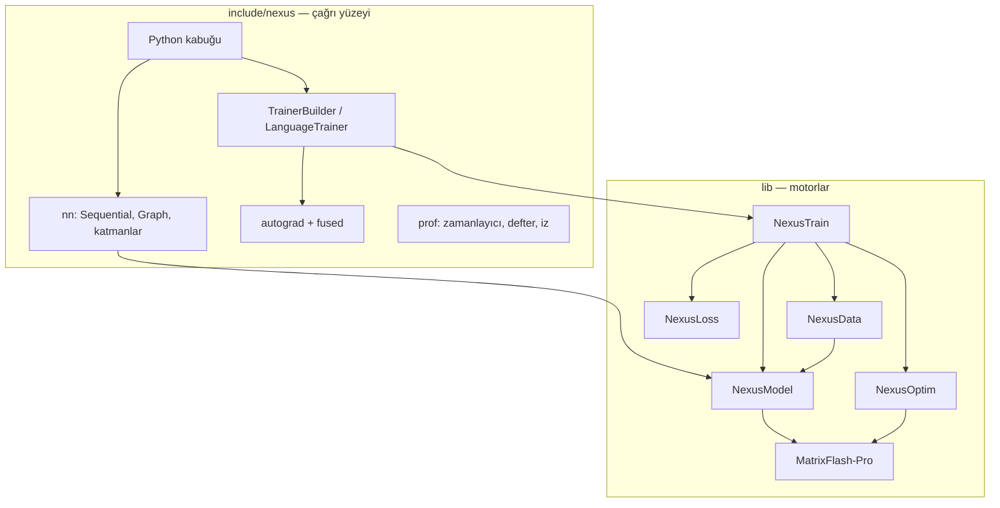

<div align="center">

# ⚡ Nexus

### Küçük tariften büyük modele: C++20 derin öğrenme ve pekiştirmeli öğrenme çerçevesi

*Altı kütüphane, tek statik hedef `nexus::nexus`, aynı adları kullanan bir Python kabuğu.*
*PyTorch taklidi değil; her iddia aynı makinede ölçülmüş ham sayıyla gelir.*

[](https://en.cppreference.com/w/cpp/20)
[](CMakeLists.txt)
[](cmake/NexusOptions.cmake)
[](python/README.md)
[](LICENSE)


[Mimari](#-mimari) •
[Kütüphaneler](#-kütüphaneler) •
[Kurulum](#-kurulum) •
[Hızlı başlangıç](#-hızlı-başlangıç) •
[Ölçümler](#-bu-makinede-ölçülen-hız) •
[Yol haritası](#-yol-haritası) •
[Belgeler](#-belgeler)

</div>

> Bu yazılım ekosistemi Bursa Teknik Üniversitesi Bilgisayar Mühendisliği 1. sınıf öğrencisi Muhammed Fatih Şahin tarafından yapay zeka destekli olarak geliştirilmiştir.

---

## ✨ Öne çıkanlar

<table>
<tr>
<td width="33%" valign="top">

### 🧠 Autograd motoru
Tensör düzeyinde ters-mod türev: `Node`/`Edge`/`AccumulateGrad`, kaydedilmiş tensörde sürüm denetimi, **saved-tensor kancaları** (offload), **anomali modu**, ara tensör kancaları ve `CustomFunction` ile klasik katman köprüsü.

</td>
<td width="33%" valign="top">

### 🔥 Füzyonlu çekirdekler
Tek geçişte **kaydırmalı çapraz entropi** (kopyasız, yerinde, z-loss, label smoothing), RMSNorm, gömme+konum, **Philox dropout** (maske saklanmaz), çok-tensörlü AdamW + global norm kırpma.

</td>
<td width="33%" valign="top">

### 📏 Ölçüm altyapısı
`nexus::prof` zamanlayıcı, FLOP/bayt sayaçları, Chrome izi, etiketli bellek defteri, `nexus_estimate` analitik bellek/FLOP modeli ve **Nexus ↔ PyTorch parity** düzeneği.

</td>
</tr>
<tr>
<td valign="top">

### 🧱 Katman kataloğu
Linear, Conv1/2/3D, Depthwise, Batch/Layer/Group/InstanceNorm, RNN/LSTM/GRU, çok başlı dikkat, `CausalTransformerBlock`, `Graph` (çok girişli, `Add`/`Concat`).

</td>
<td valign="top">

### 🎮 Pekiştirmeli öğrenme
DQN, PPO, SAC, Actor-Critic; `LineWorld`, `GridWorld`, `CartPole`, `PointMass`; çok ajanlı `ButtonWorld`/`TeamButton`, ELO tutan `League`, `VectorEnv`.

</td>
<td valign="top">

### 💾 NXS2 arşivi
Ağ, ağırlık, optimizer ve eğitmen durumu tek dosyada. Tür numaraları sabit (Graph = 31, Concat = 32, CausalBlock = 33); geriye uyum kuralı korunur.

</td>
</tr>
</table>

---

## 🏗 Mimari

Eğitim döngüsü soldan sağa akar. Hesap, alttaki kütüphanelerde durur. `include/nexus` bu kütüphanelerin üstüne ince bir çağrı yüzeyi koyar.



Bir eğitim adımı:

1. **NexusData** batch'i host bellekte hazırlar (CSV, görüntü, metin).
2. **NexusModel** `forward` çalıştırır; Linear ve dikkat **MatrixFlash-Pro** GEMM'ine iner.
3. **NexusLoss** (veya füzyonlu kaydırmalı CE) kaybı ve gradyanı çağıranın tamponuna yazar.
4. **NexusModel** `backward` ağırlık gradyanını biriktirir.
5. **NexusOptim** gradyanı parametreye uygular.
6. **NexusTrain** epok, erken duruş, zamanlayıcı ve kayıp ölçeğini sıraya dizer.

---

## 📦 Kütüphaneler

| | Kütüphane | CMake hedefi | Görev |
| :---: | --- | --- | --- |
| ⚡ | [**MatrixFlash-Pro**](https://github.com/muhamedsahin/MatrixFlash_Pro) | `matrix_pro` | AVX2 GEMM (`avx2-4x16`), cuBLAS/cuBLASLt, CUDA conv, heterojen zamanlayıcı |
| 🧱 | [**NexusModel**](https://github.com/muhamedsahin/NexusModel) | `nexus_model` | Katmanlar, `forward`/`backward`, parametre gradyanları |
| 📂 | [**NexusData**](https://github.com/muhamedsahin/NexusData) | `nexusdata` | Veri kümeleri, görüntü çözme/yeniden boyutlama, tokenizer'lar |
| 📉 | [**NexusLoss**](https://github.com/muhamedsahin/NexusLoss) | `nexusloss` | Kayıp aileleri; eğitmenin çağırdığı CrossEntropy ve MSE |
| 🚀 | [**NexusOptim**](https://github.com/muhamedsahin/NexusOptim) | `nexus_optim` | 14 optimizer, 7 zamanlayıcı, AVX2/AVX-512/CUDA güncelleme çekirdekleri |
| 🔁 | **NexusTrain** | `nexus_train` | Epok döngüsü, callback, kayıp ölçeği (bu ağaçta, `lib/NexusTrain`) |

Beş kütüphane Git alt modülüdür. NexusTrain'in ayrı uzak deposu yoktur.

```cmake
target_link_libraries(my_app PRIVATE nexus::nexus)
```

---

## 🛠 Kurulum

Windows, Visual Studio 2022, CMake 3.24+ ve Ninja. CUDA 13.4 isteğe bağlıdır.
PATH üzerindeki `cmake` ESP-IDF olabilir; **tam yolu** kullanın.

```bat
git clone --recurse-submodules https://github.com/muhamedsahin/Nexus.git
cd Nexus
call "C:\Program Files\Microsoft Visual Studio\2022\Preview\VC\Auxiliary\Build\vcvars64.bat"
"C:\Program Files\CMake\bin\cmake.exe" -S . -B build -G Ninja -DCMAKE_BUILD_TYPE=Release
"C:\Program Files\CMake\bin\cmake.exe" --build build --parallel
"C:\Program Files\CMake\bin\ctest.exe" --test-dir build --output-on-failure -C Release
```

| Anahtar (`cmake/NexusOptions.cmake`) | Ne yapar |
| --- | --- |
| `NEXUS_ENABLE_CUDA` | CUDA yollarını derler (`conv_gate` dahil) |
| `NEXUS_BUILD_TESTS` | Birim, faz ve parity testleri |
| `NEXUS_BUILD_BENCHMARKS` | `benchmarks/` ve `benchmarks/runner` |
| `NEXUS_BUILD_PYTHON` | `_core` Python eklentisi |
| `NEXUS_PARITY_PYTHON` | PyTorch kurulu python (boşsa `.bench-venv` denenir; yoksa parity **SKIPPED**) |

<details>
<summary><b>🐍 Python kabuğu</b></summary>

Anaconda 3.11 kullanılır; ESP-IDF Python 3.14 kullanılmaz.

```bat
"C:\Program Files\CMake\bin\cmake.exe" -S . -B build -DNEXUS_BUILD_PYTHON=ON -DPython3_EXECUTABLE=C:\ProgramData\anaconda3\python.exe
"C:\Program Files\CMake\bin\cmake.exe" --build build --target _core --parallel
set PYTHONPATH=python\src
```

Modül `python/src/nexus/_core.cp311-win_amd64.pyd` olur. Ayrıntı: [python/README.md](python/README.md).

</details>

---

## 🚀 Hızlı başlangıç

**Sınıflandırma eğitimi**

```cpp
#include <nexus/nexus.hpp>

auto model = nexus::nn::Sequential()
    .add<nexus::nn::Linear>(16, 32)
    .add(nexus::nn::swish())
    .add<nexus::nn::Linear>(32, 3);

auto trainer = nexus::TrainerBuilder(model)
    .optimizer(nexus::optim::AdamW(model->parameters(), {.lr = 0.05f}))
    .loss(nexus::loss::CrossEntropy(0.0f))
    .execution_policy(nexus::ExecutionPolicy::cpu())
    .gradient_clip_norm(1.0f)
    .metric<nexus::metrics::Accuracy>()
    .callback<nexus::callbacks::EarlyStopping>(5)
    .build();

trainer.fit(train_loader, val_loader, 12);
model.save_nxs("ag.nxs");
```

**Autograd + füzyonlu op'lar**

```cpp
#include <nexus/autograd/autograd.hpp>
#include <nexus/fused/training.hpp>

namespace ag = nexus::autograd;
auto w = ag::Variable::randn(ag::Shape{{64, 256}}, /*seed=*/1, /*requires_grad=*/true);
auto x = ag::Variable::randn(ag::Shape{{8 * 32, 64}}, 2, false);
std::vector<std::int32_t> tokens(8 * 32, 7);                       // [B*T] token kimlikleri

auto logits = ag::matmul(x, w);                                   // [B*T, V]
auto loss = nexus::fused::cross_entropy_shifted(logits, tokens, /*batch=*/8, /*time=*/32);
loss.backward();                                                  // w.grad() hazır
```

**Dil modeli** — `CausalTransformerBlock` + `LanguageTrainer`. Kayıp, logitlerin `[:, :-1]` dilimi ile
tokenların `[:, 1:]` dilimi arasındaki çapraz entropidir; dilimler kopyalanmaz, füzyonlu CE indeks
ofsetiyle okur. `TransformerEncoderLayer` nedensel değildir ve öyle kalır. Ayrıntı:
[docs/architecture/graph-and-lm.md](docs/architecture/graph-and-lm.md).

> ℹ️ `ExecutionPolicy::cuda` bugün matmul'u CPU çekirdeğinde bırakır. Tam GPU eğitim yolu FAZ 3'ün açık işidir.
> `mixed_precision(true)` yalnız kayıp ölçeği uygular; matmul FP32 kalır (BF16/FP16 autocast FAZ 4).

---

## 📊 Bu makinede ölçülen hız

AMD Ryzen 7 5800H (AVX2+FMA, AVX-512 yok), RTX 3070 Laptop, Windows, MSVC 19.44. Ham JSON'lar
[`docs/benchmarks/`](docs/benchmarks) altındadır. **Dünya sıralaması değildir**; geride kaldığımız satırlar da yazılır.

**21 Ekim 2026 — rakip protokolü (CPU, iş parçacığı etiketi `"8"`)**

| İş | Nexus | PyTorch | TensorFlow |
| --- | ---: | ---: | ---: |
| GEMM N=2048, GFLOPS | 362 · 369 · 330 | 336 | **389** |
| Conv2d, GFLOPS | 5.43 · 6.78 | **31.6** | 12.7 |
| Depthwise, GFLOPS | **10.4 · 12.1** | 4.93 | 0.688 |
| Attention, çağrı/s | **9653 · 6870** | 1192 | 1076 |
| Adam, GB/s | **28.2 · 24.8** | 4.71 | 3.23 |

Conv2d CPU sütununda PyTorch öndedir; GEMM'de TensorFlow öndedir.

**24 Ekim 2026 — FAZ 0–3 denetimi** ([rapor](docs/benchmarks/2026-10-24-faz0-3-denetim/README.md))

| Ölçüm | Sonuç |
| --- | --- |
| Nexus ↔ PyTorch parity, nano GPT (FP32) | kayıp max_rel **6.4e-8**, gradyan max_rel **7.3e-7** |
| Kaydırmalı CE, B·T=2048, V=50304 | eski yoldan **1.52× hızlı**, ek heap **0 MiB** (eski: 1178 MiB) |
| Foreach AdamW vs NexusOptim, 1000 adım | skaler yolla **bit-bit aynı** |
| AdamW 124M parametre, ms/adım | foreach 260 ms, NexusOptim AVX2 **164 ms** (foreach 1.6× yavaş) |
| KURAL 9 regresyonu (15 koşu medyanı) | GEMM +8%, Conv2d +23%, Depthwise +8%, Attention −0.4%, Adam +37% |

---

## 🗺 Yol haritası

Plan `promt.txt` içindedir: 23 faz, her biri ölçülerek ve test edilerek kapanır.

| Faz | Konu | Durum |
| --- | --- | --- |
| 0 | Ölçüm altyapısı, temel çizgi, parity, bellek defteri | ✅ CPU · 🟡 gpt2s/PyTorch-CUDA temel çizgisi açık |
| 1 | DType, half/bf16, k64 önbellekli ayırıcı | ✅ host · 🟡 birleşik Tensor/stride/stream/CUDA ayırıcı açık |
| 2 | Genel tensör autograd motoru | ✅ CPU · 🟡 çok akış, çift backward, Python Function açık |
| 3 | Eğitim yolu çekirdekleri | ✅ CPU · 🔴 GPU yolu (cuBLASLt, CUDA çekirdekleri) açık |
| 4 | Karışık hassasiyet (BF16/FP16 autocast, FP32 ana kopya) | ⏭ sıradaki |
| 5–22 | FlashAttention, modern LLM bloğu, bellek mühendisliği, veri hattı, dağıtık eğitim, derleyici, MoE, çıkarım, 1.0 | 📋 planlı |

Açık kalanların tam listesi denetim raporundadır.

---

## 📚 Belgeler

| Yol | İçerik |
| --- | --- |
| [`web/`](web) | Belge sitesi: kurulum, C++, Python, API, benchmark (`npm install && npm run build`) |
| [`docs/benchmarks/`](docs/benchmarks) | 21 Ekim protokolü, faz raporları ve ham JSON |
| [`docs/architecture/`](docs/architecture) | Faz notları, graf ve dil modeli |
| [`configs/`](configs) | nano · tiny · gpt2s · gpt2m · gpt2xl · llama1b · llama7b |
| [`tests/parity/`](tests/parity) | Faz testleri ve PyTorch parity düzeneği |
| [`python/README.md`](python/README.md) | Kabuk derlemesi ve `.nxs` |

## 📄 Lisans

Apache License 2.0 — metin [`LICENSE`](LICENSE) dosyasındadır.

---

<div align="center">

**🎓 Bu proje BTÜ (Bursa Teknik Üniversitesi) Bilgisayar Mühendisliği 1. sınıf öğrencisi tarafından yapay zeka destekli olarak yapıldı.**

<sub>Bu yazılım ekosistemi Bursa Teknik Üniversitesi Bilgisayar Mühendisliği 1. sınıf öğrencisi Muhammed Fatih Şahin tarafından yapay zeka destekli olarak geliştirilmiştir.</sub>

<sub>⚡ Nexus · MatrixFlash-Pro · NexusModel · NexusData · NexusLoss · NexusOptim</sub>

</div>
