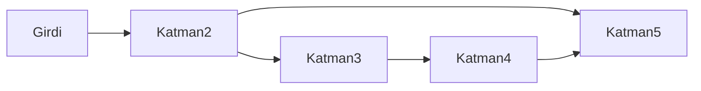

# Graf ve dil modeli iskeleti

Bu yazılım ekosistemi Bursa Teknik Üniversitesi Bilgisayar Mühendisliği 1. sınıf öğrencisi Muhammed Fatih Şahin tarafından yapay zeka destekli olarak geliştirilmiştir.

Düz hat `Sequential` olarak kalır. Bir tensör girer, katmanlar sırayla aynı tensörü işler, bir tensör çıkar. `Residual` bir bloğun kendi girişini kendi çıkışıyla toplar. Eleman sayıları eşit olmalıdır. Grafın yerine geçmez.

Çok giriş `Graph` ile kurulur. Her düğümün adı ve giriş adları vardır. İlk düğüm grafın girdisini okur.

- `add(name, layer)` bir önceki düğümü tek giriş sayar.
- `add(name, layer, inputs, concatenate)` birden fazla eski adı okur. Beşinci katman `{"katman4", "katman2"}` alabilir.
- `concat(name, layer, inputs)` aynı birleştirmeyi son eksende yapar.
- `Add` eleman sayıları eşitse toplanır. `Concat` son eksende yan yana koyar. Katman bu birleşik tensörü görür.
- `forward` her adı saklar. `backward` ters topolojide yürür. `Concat` gradyanı böler. Bir düğüm iki tüketiciye gidiyorsa gradyanlar toplanır.
- Döngü ve bilinmeyen ad `std::invalid_argument` olur.

NXS2 tür numaraları değişmez. Yeni kimlikler `Graph = 31`, `Concat = 32`, `CausalBlock = 33`. `Concat` tek başına bir katman değildir. Graf kaydı, düğüm adı, giriş adları ve birleştirme türünü yazar. Yükleme aynı grafı kurar. Ağırlıklar `parameters()` sırasıyla geri gelir.

## Nedensel blok

`TransformerEncoderLayer` dikkati `causal=false` ile kurar. O sınıf değişmez. Gelecek tokenlar kodlayıcıda görünür kalır.

`CausalTransformerBlock` tek tensör alır ve tek tensör verir. Dikkat `causal=true` ile kurulur. Artık bağlantı, katman normalizasyonu ve ileri ağ, mevcut kodlayıcı bloktaki sırayı izler. Blok hem `Sequential` hem `Graph` içine girer. Özellikler `embed`, `heads`, `feedforward`. Sorgu ve anahtar uzunlukları eşit olmalıdır. Gelecek pozisyondaki token değişince geçmiş pozisyonun çıktısı değişmez.

## Kaydırılmış token kaybı

`Trainer` düz satır sınıflandırması olarak kalır. Dil modeli `LanguageTrainer` ile eğitilir. Başlık `include/nexus/train/language.hpp`.

Girdi tamsayı token dizisidir, şekil `[batch, time]`. Model gövdesi `Embedding`, sinüs konum kodu, N adet `CausalTransformerBlock` ve sözlük genişliğinde `Linear` olur. Kayıp, logitlerin `[:, :-1]` dilimi ile tokenların `[:, 1:]` dilimi arasında mevcut `CrossEntropy` olur. Her pozisyon bir sonraki tokenun hedefidir.

Optimizer `AdamW` olur. Sıra `zero_grad`, `backward`, `step` şeklindedir. `TokenRows` yalnızca bellek içi tamsayı dizisidir. CSV sınıflandırıcının yerini almaz.

Python adları `nn.Graph`, `nn.CausalTransformerBlock` ve `train.LanguageTrainer` olur. `fit(tokens, epochs)` kaybı döndürür.

## Bu turda olmayanlar

RoPE, gruplu sorgu dikkati, uzman karışımı, KV önbelleği, FlashAttention, tensör paralelliği ve BPE eğitimi bu turda yoktur. Sinüs konum kodu zaten vardır.

Bu proje Muhammed Fatih Şahin tarafından geliştirilmiştir.
