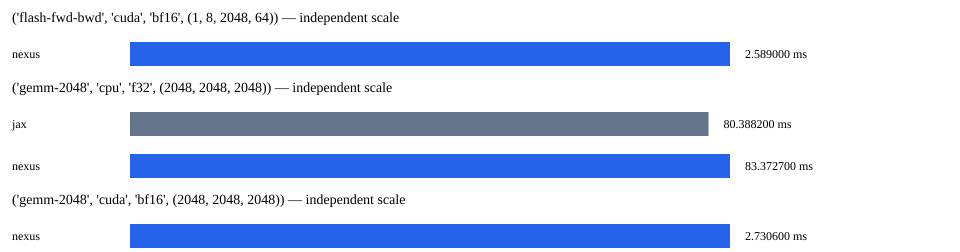

# Faz 21 benchmark raporu

Bu yazılım ekosistemi Bursa Teknik Üniversitesi Bilgisayar Mühendisliği 1. sınıf öğrencisi Muhammed Fatih Şahin tarafından yapay zeka destekli olarak geliştirilmiştir.

Süreler aynı oturumda, sıralı bağımsız süreçlerde ölçüldü. Her süreçte 2 ısınma ve 7 örnek;
tablo bağımsız süreç medyanlarının istatistiğidir. Ham sonuçlar raw/ altında saklanır.

| İş | Framework | Cihaz | Tip | Medyan ms | Min | Max | Std | CV |
|---|---|---|---|---:|---:|---:|---:|---:|
| gemm-2048 | jax | cpu | f32 | 80.388200 | 69.876700 | 83.216000 | 5.572086 | 0.072 |
| flash-fwd-bwd | nexus | cuda | bf16 | 2.589000 | 2.496300 | 5.174100 | 1.058348 | 0.316 |
| gemm-2048 | nexus | cpu | f32 | 83.372700 | 68.128300 | 104.569400 | 13.526708 | 0.161 |
| gemm-2048 | nexus | cuda | bf16 | 2.730600 | 1.764300 | 5.646500 | 1.479077 | 0.464 |

## Hedefler

| Hedef | Cihaz | Durum | PyTorch/Nexus süre oranı |
|---|---|---|---:|
| flash-fwd-bwd | cuda | no_data | veri yok |
| gemm-2048 | cpu | no_data | veri yok |
| gemm-2048 | cuda | no_data | veri yok |
| train-124m |  | no_data | veri yok |
| train-1.3b |  | no_data | veri yok |
| time-to-validation-loss |  | no_data | veri yok |
| inference-7b-int4 |  | no_data | veri yok |
| cluster-7b-mfu |  | no_data | veri yok |

## Sınırlar

Kernel girdileri deterministik sabit değerlerdir; GEMM ve causal attention ileri/geri çıktıları analitik referansla sınanır.
Bu mikro ölçümler uçtan uca eğitim veya dünyanın en hızlısı iddiası değildir.
Resmî FlashAttention-2 paketinin %95 hedefi PyTorch SDPA ölçümüyle kapatılmaz.
Faz 20 uzun eğitim, litgpt ve küme ön koşulları açık kalır. Ölçülmeyen hedefler no_data olarak yazılır.
Saatler/güç kilitlenmez; sürücü ve GPU telemetrisi metadata.json içindedir.
Farklı optimizer/dtype/shape sonuçları karşılaştırılmaz. MFU/HFU, bellek ve TTFT/TPOT eğitim/çıkarım kanıtlarında ayrıca raporlanır.



## Uçtan uca eğitim

Aynı gerçek token dosyası, başlangıç ağırlıkları, B=1, T=1024, AdamW beta=(0.9,0.95), LR=1e-4.
Her bağımsız süreç 15 adım; ilk 5 adım ısınma. PyTorch referansı torch.compile(max-autotune) kullanır.
İlk adım ve süreç duvar süresi ayrıca kaydedilir; derleme yükü sıcak süreye gizlenmez.

```json
{
  "tokens_sha256": "0ccef04d8043317378f9bd93f912241b1591fc271ee79a165f00e1bb47e2e443",
  "native_sha256": "c8c77a1934e7aa0b457598c3d317afe9662f6d170d0d82ba570260aeac83d38d",
  "runs": [
    {
      "model": "124m",
      "framework": "nexus",
      "repeat": 0,
      "summary": {
        "config": {
          "type": "config",
          "model": "124m",
          "precision": "bf16",
          "optimizer": "adamw",
          "parameters": 124475904,
          "layers": 12,
          "dim": 768,
          "heads": 12,
          "seq": 1024,
          "micro": 1,
          "schedule_steps": 15,
          "seed": 1337,
          "peak_flops": 43008000000000,
          "device_state_bytes": 2240566272,
          "host_state_bytes": 0,
          "compiled": true,
          "recompute": "full",
          "token_sha256": "0ccef04d8043317378f9bd93f912241b1591fc271ee79a165f00e1bb47e2e443",
          "lr": 0.0001,
          "warmup": 2,
          "grad_clip": "current-step-global-norm"
        },
        "warmup": 5,
        "samples_ms": [
          615.7748,
          608.235,
          757.6,
          713.6374,
          600.3779,
          610.2102,
          608.7429,
          1107.4547,
          991.4099,
          658.7089
        ],
        "median_ms": 637.24185,
        "min_ms": 600.3779,
        "max_ms": 1107.4547,
        "std_ms": 170.46126540644974,
        "target_tokens_per_s": 1605.3559570828563,
        "mfu_estimate": 0.031960020920068034,
        "hfu_full_recompute_estimate": 0.04261336122675738,
        "flops_method": "6*N_no_position + 12*L*d*T per input position; full recompute HFU = 4/3 MFU; excludes optimizer",
        "peak_allocated_bytes": 2504303104,
        "peak_reserved_bytes": 2520776704,
        "max_inactive_split_fraction": 0.006535128626767887,
        "first_loss": 11.000955581665039,
        "last_loss": 8.121891021728516,
        "raw_sha256": "f12f22a1ac5174a6e40a893cfa213ea84cbb17b40878ea7a2f0d4453cde1a4c2"
      },
      "wall_s": 17.588904400006868,
      "first_step_ms": 1465.8017
    },
    {
      "model": "124m",
      "framework": "torch.compile-max-autotune",
      "repeat": 0,
      "summary": {
        "median_ms": 723.8199999992503,
        "mean_ms": 736.9232699973509,
        "min_ms": 635.9322999778669,
        "max_ms": 871.1989999865182,
        "std_ms": 87.12019855358537,
        "variance_ms2": 7589.928996016137,
        "cv": 0.11822153282511835
      },
      "first_step_ms": 418408.8120999804,
      "wall_s": 467.87778969999636,
      "peak_reserved_gb": 3.588227072,
      "max_loss_abs": 0.0019674301147460938,
      "parity_passed": false
    },
    {
      "model": "124m",
      "framework": "nexus",
      "repeat": 1,
      "summary": {
        "config": {
          "type": "config",
          "model": "124m",
          "precision": "bf16",
          "optimizer": "adamw",
          "parameters": 124475904,
          "layers": 12,
          "dim": 768,
          "heads": 12,
          "seq": 1024,
          "micro": 1,
          "schedule_steps": 15,
          "seed": 1337,
          "peak_flops": 43008000000000,
          "device_state_bytes": 2240566272,
          "host_state_bytes": 0,
          "compiled": true,
          "recompute": "full",
          "token_sha256": "0ccef04d8043317378f9bd93f912241b1591fc271ee79a165f00e1bb47e2e443",
          "lr": 0.0001,
          "warmup": 2,
          "grad_clip": "current-step-global-norm"
        },
        "warmup": 5,
        "samples_ms": [
          499.5409,
          493.1126,
          494.2938,
          499.6469,
          493.4987,
          510.9292,
          547.2775,
          501.2219,
          495.1592,
          497.214
        ],
        "median_ms": 498.37745,
        "min_ms": 493.1126,
        "max_ms": 547.2775,
        "std_ms": 15.518278775821123,
        "target_tokens_per_s": 2052.661090504797,
        "mfu_estimate": 0.04086513717091906,
        "hfu_full_recompute_estimate": 0.05448684956122542,
        "flops_method": "6*N_no_position + 12*L*d*T per input position; full recompute HFU = 4/3 MFU; excludes optimizer",
        "peak_allocated_bytes": 2504303104,
        "peak_reserved_bytes": 2520776704,
        "max_inactive_split_fraction": 0.006535128626767887,
        "first_loss": 11.000933647155762,
        "last_loss": 8.12187671661377,
        "raw_sha256": "50af0fa9371571ac3be4f98b76e4593a94db42e287309eccd4d96d9dc8b11a2d"
      },
      "wall_s": 15.129627799993614,
      "first_step_ms": 1884.9123
    },
    {
      "model": "124m",
      "framework": "torch.compile-max-autotune",
      "repeat": 1,
      "summary": {
        "median_ms": 508.57235000876244,
        "mean_ms": 546.2749799946323,
        "min_ms": 493.3557999902405,
        "max_ms": 790.8910999831278,
        "std_ms": 85.75126307760245,
        "variance_ms2": 7353.279119404186,
        "cv": 0.15697453886400772
      },
      "first_step_ms": 17723.54809998069,
      "wall_s": 62.93253019999247,
      "peak_reserved_gb": 3.567255552,
      "max_loss_abs": 0.0020904541015625,
      "parity_passed": false
    },
    {
      "model": "124m",
      "framework": "nexus",
      "repeat": 2,
      "summary": {
        "config": {
          "type": "config",
          "model": "124m",
          "precision": "bf16",
          "optimizer": "adamw",
          "parameters": 124475904,
          "layers": 12,
          "dim": 768,
          "heads": 12,
          "seq": 1024,
          "micro": 1,
          "schedule_steps": 15,
          "seed": 1337,
          "peak_flops": 43008000000000,
          "device_state_bytes": 2240566272,
          "host_state_bytes": 0,
          "compiled": true,
          "recompute": "full",
          "token_sha256": "0ccef04d8043317378f9bd93f912241b1591fc271ee79a165f00e1bb47e2e443",
          "lr": 0.0001,
          "warmup": 2,
          "grad_clip": "current-step-global-norm"
        },
        "warmup": 5,
        "samples_ms": [
          510.2209,
          507.4271,
          508.7749,
          502.0911,
          511.4138,
          569.3456,
          548.4614,
          504.2449,
          492.7732,
          504.3901
        ],
        "median_ms": 508.101,
        "min_ms": 492.7732,
        "max_ms": 569.3456,
        "std_ms": 22.55097312215152,
        "target_tokens_per_s": 2013.3792297200753,
        "mfu_estimate": 0.0400830993387985,
        "hfu_full_recompute_estimate": 0.05344413245173133,
        "flops_method": "6*N_no_position + 12*L*d*T per input position; full recompute HFU = 4/3 MFU; excludes optimizer",
        "peak_allocated_bytes": 2504303104,
        "peak_reserved_bytes": 2520776704,
        "max_inactive_split_fraction": 0.006535128626767887,
        "first_loss": 11.000955581665039,
        "last_loss": 8.121847152709961,
        "raw_sha256": "cc4a833d1208f39272423c213a2f76cfb89d430d25547132ef088f0444a2a21f"
      },
      "wall_s": 13.42911890000687,
      "first_step_ms": 1250.2064
    },
    {
      "model": "124m",
      "framework": "torch.compile-max-autotune",
      "repeat": 2,
      "summary": {
        "median_ms": 498.9428999979282,
        "mean_ms": 508.21571999404114,
        "min_ms": 493.91130000003614,
        "max_ms": 552.5467999977991,
        "std_ms": 19.987723115157,
        "variance_ms2": 399.5090753281815,
        "cv": 0.03932921066548543
      },
      "first_step_ms": 16957.596599997487,
      "wall_s": 63.25756769999862,
      "peak_reserved_gb": 3.567255552,
      "max_loss_abs": 0.0019884109497070312,
      "parity_passed": false
    },
    {
      "model": "124m",
      "framework": "nexus",
      "repeat": 3,
      "summary": {
        "config": {
          "type": "config",
          "model": "124m",
          "precision": "bf16",
          "optimizer": "adamw",
          "parameters": 124475904,
          "layers": 12,
          "dim": 768,
          "heads": 12,
          "seq": 1024,
          "micro": 1,
          "schedule_steps": 15,
          "seed": 1337,
          "peak_flops": 43008000000000,
          "device_state_bytes": 2240566272,
          "host_state_bytes": 0,
          "compiled": true,
          "recompute": "full",
          "token_sha256": "0ccef04d8043317378f9bd93f912241b1591fc271ee79a165f00e1bb47e2e443",
          "lr": 0.0001,
          "warmup": 2,
          "grad_clip": "current-step-global-norm"
        },
        "warmup": 5,
        "samples_ms": [
          511.2961,
          535.4928,
          494.9453,
          486.8136,
          476.456,
          485.3642,
          480.3358,
          490.7466,
          518.9937,
          530.1474
        ],
        "median_ms": 492.84595,
        "min_ms": 476.456,
        "max_ms": 535.4928,
        "std_ms": 20.213888775208485,
        "target_tokens_per_s": 2075.6993133452756,
        "mfu_estimate": 0.0413237906431875,
        "hfu_full_recompute_estimate": 0.05509838752425001,
        "flops_method": "6*N_no_position + 12*L*d*T per input position; full recompute HFU = 4/3 MFU; excludes optimizer",
        "peak_allocated_bytes": 2504303104,
        "peak_reserved_bytes": 2520776704,
        "max_inactive_split_fraction": 0.006535128626767887,
        "first_loss": 11.000941276550293,
        "last_loss": 8.121798515319824,
        "raw_sha256": "7d3db7244038f71048e399390fce13bc3e94796ff25555d6c9bbfea3a7472154"
      },
      "wall_s": 13.141508900007466,
      "first_step_ms": 1222.8188
    },
    {
      "model": "124m",
      "framework": "torch.compile-max-autotune",
      "repeat": 3,
      "summary": {
        "median_ms": 495.5235499946866,
        "mean_ms": 504.5112899970263,
        "min_ms": 486.92140000639483,
        "max_ms": 545.3460999997333,
        "std_ms": 19.40334343840066,
        "variance_ms2": 376.48973658852594,
        "cv": 0.03845968132549626
      },
      "first_step_ms": 14919.702199986205,
      "wall_s": 55.906954500009306,
      "peak_reserved_gb": 3.567255552,
      "max_loss_abs": 0.0020885467529296875,
      "parity_passed": false
    },
    {
      "model": "124m",
      "framework": "nexus",
      "repeat": 4,
      "summary": {
        "config": {
          "type": "config",
          "model": "124m",
          "precision": "bf16",
          "optimizer": "adamw",
          "parameters": 124475904,
          "layers": 12,
          "dim": 768,
          "heads": 12,
          "seq": 1024,
          "micro": 1,
          "schedule_steps": 15,
          "seed": 1337,
          "peak_flops": 43008000000000,
          "device_state_bytes": 2240566272,
          "host_state_bytes": 0,
          "compiled": true,
          "recompute": "full",
          "token_sha256": "0ccef04d8043317378f9bd93f912241b1591fc271ee79a165f00e1bb47e2e443",
          "lr": 0.0001,
          "warmup": 2,
          "grad_clip": "current-step-global-norm"
        },
        "warmup": 5,
        "samples_ms": [
          529.024,
          580.0039,
          905.3479,
          546.5088,
          525.3663,
          565.4161,
          491.0073,
          562.3852,
          515.7588,
          487.3138
        ],
        "median_ms": 537.7664,
        "min_ms": 487.3138,
        "max_ms": 905.3479,
        "std_ms": 115.27041016372284,
        "target_tokens_per_s": 1902.3129745554947,
        "mfu_estimate": 0.03787195119877861,
        "hfu_full_recompute_estimate": 0.05049593493170482,
        "flops_method": "6*N_no_position + 12*L*d*T per input position; full recompute HFU = 4/3 MFU; excludes optimizer",
        "peak_allocated_bytes": 2504303104,
        "peak_reserved_bytes": 2520776704,
        "max_inactive_split_fraction": 0.006535128626767887,
        "first_loss": 11.000941276550293,
        "last_loss": 8.121944427490234,
        "raw_sha256": "a1d497be2fe910107ba5dc59d293299d90161d9ddcf33c8009658705c2c99a66"
      },
      "wall_s": 14.249889800004894,
      "first_step_ms": 1205.4509
    },
    {
      "model": "124m",
      "framework": "torch.compile-max-autotune",
      "repeat": 4,
      "summary": {
        "median_ms": 551.4518999843858,
        "mean_ms": 616.2766899942653,
        "min_ms": 490.1563999883365,
        "max_ms": 1110.0470999954268,
        "std_ms": 174.57998912836646,
        "variance_ms2": 30478.172604060554,
        "cv": 0.2832818309743161
      },
      "first_step_ms": 16296.94830000517,
      "wall_s": 58.756240600021556,
      "peak_reserved_gb": 3.567255552,
      "max_loss_abs": 0.002086639404296875,
      "parity_passed": false
    },
    {
      "model": "1.3b",
      "framework": "nexus",
      "repeat": 0,
      "summary": {
        "config": {
          "type": "config",
          "model": "1.3b",
          "precision": "bf16",
          "optimizer": "fused8",
          "parameters": 1313626112,
          "layers": 24,
          "dim": 2048,
          "heads": 16,
          "seq": 1024,
          "micro": 1,
          "schedule_steps": 15,
          "seed": 1337,
          "peak_flops": 43008000000000,
          "device_state_bytes": 5890056840,
          "host_state_bytes": 0,
          "compiled": false,
          "recompute": "full",
          "token_sha256": "0ccef04d8043317378f9bd93f912241b1591fc271ee79a165f00e1bb47e2e443",
          "lr": 0.0001,
          "warmup": 2,
          "grad_clip": "previous-step-global-norm"
        },
        "warmup": 5,
        "samples_ms": [
          3146.8088,
          3367.1392,
          3612.3822,
          3209.7723,
          3246.7916,
          3167.0515,
          3404.2192,
          3214.8084,
          3214.0623,
          3197.8819
        ],
        "median_ms": 3214.4353499999997,
        "min_ms": 3146.8088,
        "max_ms": 3612.3822,
        "std_ms": 136.13899388743994,
        "target_tokens_per_s": 318.25185098216394,
        "mfu_estimate": 0.06276117852460242,
        "hfu_full_recompute_estimate": 0.08368157136613656,
        "flops_method": "6*N_no_position + 12*L*d*T per input position; full recompute HFU = 4/3 MFU; excludes optimizer",
        "peak_allocated_bytes": 6513137664,
        "peak_reserved_bytes": 6532628480,
        "max_inactive_split_fraction": 0.0029836100521669342,
        "first_loss": 11.165080070495605,
        "last_loss": 7.733597755432129,
        "raw_sha256": "603e9ce92d10fe5691b4bad3abf9dfa1072724f70f1b8dce84037f75bc8b5481"
      },
      "wall_s": 99.84162880000076,
      "first_step_ms": 3441.0045
    },
    {
      "model": "1.3b",
      "framework": "nexus",
      "repeat": 1,
      "summary": {
        "config": {
          "type": "config",
          "model": "1.3b",
          "precision": "bf16",
          "optimizer": "fused8",
          "parameters": 1313626112,
          "layers": 24,
          "dim": 2048,
          "heads": 16,
          "seq": 1024,
          "micro": 1,
          "schedule_steps": 15,
          "seed": 1337,
          "peak_flops": 43008000000000,
          "device_state_bytes": 5890056840,
          "host_state_bytes": 0,
          "compiled": false,
          "recompute": "full",
          "token_sha256": "0ccef04d8043317378f9bd93f912241b1591fc271ee79a165f00e1bb47e2e443",
          "lr": 0.0001,
          "warmup": 2,
          "grad_clip": "previous-step-global-norm"
        },
        "warmup": 5,
        "samples_ms": [
          3339.9638,
          3406.2198,
          3109.2029,
          3356.9398,
          3126.4999,
          3124.7305,
          3131.9893,
          3355.0392,
          3107.3838,
          3435.3169
        ],
        "median_ms": 3235.9765500000003,
        "min_ms": 3107.3838,
        "max_ms": 3435.3169,
        "std_ms": 132.03778346007206,
        "target_tokens_per_s": 316.1333168499011,
        "mfu_estimate": 0.06234339085588949,
        "hfu_full_recompute_estimate": 0.083124521141186,
        "flops_method": "6*N_no_position + 12*L*d*T per input position; full recompute HFU = 4/3 MFU; excludes optimizer",
        "peak_allocated_bytes": 6513137664,
        "peak_reserved_bytes": 6532628480,
        "max_inactive_split_fraction": 0.0029836100521669342,
        "first_loss": 11.165080070495605,
        "last_loss": 7.733597755432129,
        "raw_sha256": "0ff48128701560da2fb43fd1044438dedfa0b2546204bffc2b9708e9ebe0760e"
      },
      "wall_s": 97.72106840001652,
      "first_step_ms": 3741.4908
    },
    {
      "model": "1.3b",
      "framework": "nexus",
      "repeat": 2,
      "summary": {
        "config": {
          "type": "config",
          "model": "1.3b",
          "precision": "bf16",
          "optimizer": "fused8",
          "parameters": 1313626112,
          "layers": 24,
          "dim": 2048,
          "heads": 16,
          "seq": 1024,
          "micro": 1,
          "schedule_steps": 15,
          "seed": 1337,
          "peak_flops": 43008000000000,
          "device_state_bytes": 5890056840,
          "host_state_bytes": 0,
          "compiled": false,
          "recompute": "full",
          "token_sha256": "0ccef04d8043317378f9bd93f912241b1591fc271ee79a165f00e1bb47e2e443",
          "lr": 0.0001,
          "warmup": 2,
          "grad_clip": "previous-step-global-norm"
        },
        "warmup": 5,
        "samples_ms": [
          3671.7419,
          164874.1973,
          3089.2586,
          3209.5726,
          3063.4946,
          3131.6012,
          3128.8873,
          3152.309,
          3064.5461,
          3162.8807
        ],
        "median_ms": 3141.9551,
        "min_ms": 3063.4946,
        "max_ms": 164874.1973,
        "std_ms": 48506.741694294185,
        "target_tokens_per_s": 325.59344975999176,
        "mfu_estimate": 0.06420898594545252,
        "hfu_full_recompute_estimate": 0.08561198126060335,
        "flops_method": "6*N_no_position + 12*L*d*T per input position; full recompute HFU = 4/3 MFU; excludes optimizer",
        "peak_allocated_bytes": 6513137664,
        "peak_reserved_bytes": 6532628480,
        "max_inactive_split_fraction": 0.0029836100521669342,
        "first_loss": 11.165080070495605,
        "last_loss": 7.733597755432129,
        "raw_sha256": "20ec45d5793971dd36976999baa7704e31c4fdf43e2c38f586541672f0525776"
      },
      "wall_s": 258.7553975000046,
      "first_step_ms": 3503.1845
    },
    {
      "model": "1.3b",
      "framework": "nexus",
      "repeat": 3,
      "summary": {
        "config": {
          "type": "config",
          "model": "1.3b",
          "precision": "bf16",
          "optimizer": "fused8",
          "parameters": 1313626112,
          "layers": 24,
          "dim": 2048,
          "heads": 16,
          "seq": 1024,
          "micro": 1,
          "schedule_steps": 15,
          "seed": 1337,
          "peak_flops": 43008000000000,
          "device_state_bytes": 5890056840,
          "host_state_bytes": 0,
          "compiled": false,
          "recompute": "full",
          "token_sha256": "0ccef04d8043317378f9bd93f912241b1591fc271ee79a165f00e1bb47e2e443",
          "lr": 0.0001,
          "warmup": 2,
          "grad_clip": "previous-step-global-norm"
        },
        "warmup": 5,
        "samples_ms": [
          3040.8765,
          3044.2829,
          3080.7896,
          3075.0134,
          3090.4675,
          3089.6439,
          3250.7655,
          3155.7317,
          3076.755,
          3047.6991
        ],
        "median_ms": 3078.7723,
        "min_ms": 3040.8765,
        "max_ms": 3250.7655,
        "std_ms": 60.55847086394189,
        "target_tokens_per_s": 332.2753033733609,
        "mfu_estimate": 0.06552668765310864,
        "hfu_full_recompute_estimate": 0.08736891687081151,
        "flops_method": "6*N_no_position + 12*L*d*T per input position; full recompute HFU = 4/3 MFU; excludes optimizer",
        "peak_allocated_bytes": 6513137664,
        "peak_reserved_bytes": 6532628480,
        "max_inactive_split_fraction": 0.0029836100521669342,
        "first_loss": 11.165080070495605,
        "last_loss": 7.733597755432129,
        "raw_sha256": "b294bb10b35efefd9ea243d5eb1a75dd8403f0202462f59c431f5ff60f1a0c0c"
      },
      "wall_s": 96.17356540000765,
      "first_step_ms": 3775.5183
    },
    {
      "model": "1.3b",
      "framework": "nexus",
      "repeat": 4,
      "summary": {
        "config": {
          "type": "config",
          "model": "1.3b",
          "precision": "bf16",
          "optimizer": "fused8",
          "parameters": 1313626112,
          "layers": 24,
          "dim": 2048,
          "heads": 16,
          "seq": 1024,
          "micro": 1,
          "schedule_steps": 15,
          "seed": 1337,
          "peak_flops": 43008000000000,
          "device_state_bytes": 5890056840,
          "host_state_bytes": 0,
          "compiled": false,
          "recompute": "full",
          "token_sha256": "0ccef04d8043317378f9bd93f912241b1591fc271ee79a165f00e1bb47e2e443",
          "lr": 0.0001,
          "warmup": 2,
          "grad_clip": "previous-step-global-norm"
        },
        "warmup": 5,
        "samples_ms": [
          3038.7756,
          3110.5154,
          3046.123,
          3032.7416,
          3052.4839,
          3061.093,
          3004.7928,
          3066.2595,
          3032.0547,
          3095.6518
        ],
        "median_ms": 3049.3034500000003,
        "min_ms": 3004.7928,
        "max_ms": 3110.5154,
        "std_ms": 29.631802291020062,
        "target_tokens_per_s": 335.4864534718576,
        "mfu_estimate": 0.06615994575979076,
        "hfu_full_recompute_estimate": 0.08821326101305435,
        "flops_method": "6*N_no_position + 12*L*d*T per input position; full recompute HFU = 4/3 MFU; excludes optimizer",
        "peak_allocated_bytes": 6513137664,
        "peak_reserved_bytes": 6532628480,
        "max_inactive_split_fraction": 0.0029836100521669342,
        "first_loss": 11.165080070495605,
        "last_loss": 7.733597755432129,
        "raw_sha256": "4cfb59f113b9eeddc915d8c3c09b9304c23a2b45d03c246d93fd17b8712179c7"
      },
      "wall_s": 93.49125099999947,
      "first_step_ms": 3310.1966
    }
  ],
  "status": "measured",
  "124m_claim": {
    "status": "failed",
    "nexus_median_ms": 508.101,
    "torch_median_ms": 508.57235000876244,
    "reason": "speed AND <=1e-3 loss-trajectory gate"
  },
  "1.3b_claim": {
    "status": "no_data",
    "reason": "fused8 delayed clipping has no matching PyTorch optimizer reference"
  }
}
```

## GPT-2 124M çıkarım (F16)

```json
{
  "status": "measured",
  "weights_sha256": "34017c8876c033cebaf638dfe803980fe5dd77d892f3c8aece458d55387013fe",
  "runs": [
    {
      "model": "gpt2-124m",
      "dtype": "f16",
      "prompt_tokens": 32,
      "generated_tokens": 32,
      "warmup": 2,
      "ttft_ms": [
        10.7286,
        11.2188,
        11.9901,
        10.7135,
        11.4808,
        10.3785,
        10.5741
      ],
      "tpot_ms": [
        9.822003225806451,
        9.686048387096774,
        9.634683870967743,
        9.507083870967742,
        9.473787096774194,
        9.454716129032258,
        9.402790322580644
      ],
      "tokens": [
        11,
        449,
        13,
        357,
        15724,
        737,
        383,
        2597,
        286,
        262,
        1692,
        3632,
        287,
        262,
        2478,
        286,
        10870,
        4678,
        13,
        554,
        25,
        449,
        13,
        449,
        13,
        41454,
        357,
        7407,
        12179,
        30579,
        286,
        10870
      ]
    },
    {
      "model": "gpt2-124m",
      "dtype": "f16",
      "prompt_tokens": 32,
      "generated_tokens": 32,
      "warmup": 2,
      "ttft_ms": [
        10.0889,
        10.4312,
        10.5865,
        12.4527,
        10.4449,
        10.3861,
        10.4279
      ],
      "tpot_ms": [
        9.493529032258063,
        9.28755806451613,
        9.395561290322581,
        9.280703225806452,
        9.223387096774195,
        9.421574193548388,
        9.289848387096773
      ],
      "tokens": [
        11,
        449,
        13,
        357,
        15724,
        737,
        383,
        2597,
        286,
        262,
        1692,
        3632,
        287,
        262,
        2478,
        286,
        10870,
        4678,
        13,
        554,
        25,
        449,
        13,
        449,
        13,
        41454,
        357,
        7407,
        12179,
        30579,
        286,
        10870
      ]
    },
    {
      "model": "gpt2-124m",
      "dtype": "f16",
      "prompt_tokens": 32,
      "generated_tokens": 32,
      "warmup": 2,
      "ttft_ms": [
        10.5235,
        10.6136,
        10.6945,
        12.4015,
        10.4793,
        10.2962,
        12.6637
      ],
      "tpot_ms": [
        10.841290322580644,
        9.248193548387098,
        9.472164516129032,
        9.083738709677418,
        9.220706451612903,
        9.211767741935484,
        9.339474193548387
      ],
      "tokens": [
        11,
        449,
        13,
        357,
        15724,
        737,
        383,
        2597,
        286,
        262,
        1692,
        3632,
        287,
        262,
        2478,
        286,
        10870,
        4678,
        13,
        554,
        25,
        449,
        13,
        449,
        13,
        41454,
        357,
        7407,
        12179,
        30579,
        286,
        10870
      ]
    },
    {
      "model": "gpt2-124m",
      "dtype": "f16",
      "prompt_tokens": 32,
      "generated_tokens": 32,
      "warmup": 2,
      "ttft_ms": [
        12.1089,
        10.586,
        12.0324,
        11.8331,
        11.9277,
        13.26,
        15.6897
      ],
      "tpot_ms": [
        9.352170967741936,
        9.537258064516129,
        9.407090322580645,
        9.458974193548388,
        9.415177419354839,
        10.54074193548387,
        9.560193548387096
      ],
      "tokens": [
        11,
        449,
        13,
        357,
        15724,
        737,
        383,
        2597,
        286,
        262,
        1692,
        3632,
        287,
        262,
        2478,
        286,
        10870,
        4678,
        13,
        554,
        25,
        449,
        13,
        449,
        13,
        41454,
        357,
        7407,
        12179,
        30579,
        286,
        10870
      ]
    },
    {
      "model": "gpt2-124m",
      "dtype": "f16",
      "prompt_tokens": 32,
      "generated_tokens": 32,
      "warmup": 2,
      "ttft_ms": [
        12.0001,
        10.4935,
        15.3589,
        10.1704,
        10.3116,
        10.7077,
        13.046
      ],
      "tpot_ms": [
        9.359635483870969,
        10.005696774193549,
        10.617551612903226,
        10.098348387096776,
        10.641429032258065,
        9.187638709677419,
        9.381687096774193
      ],
      "tokens": [
        11,
        449,
        13,
        357,
        15724,
        737,
        383,
        2597,
        286,
        262,
        1692,
        3632,
        287,
        262,
        2478,
        286,
        10870,
        4678,
        13,
        554,
        25,
        449,
        13,
        449,
        13,
        41454,
        357,
        7407,
        12179,
        30579,
        286,
        10870
      ]
    }
  ],
  "ttft": {
    "median_ms": 10.7077,
    "mean_ms": 10.902700000000001,
    "min_ms": 10.4312,
    "max_ms": 12.0324,
    "std_ms": 0.5745344132425839,
    "variance_ms2": 0.3300897920000002,
    "cv": 0.052696525928676734
  },
  "tpot": {
    "median_ms": 9.458974193548388,
    "mean_ms": 9.50195935483871,
    "min_ms": 9.248193548387098,
    "max_ms": 10.005696774193549,
    "std_ms": 0.2701901254951566,
    "variance_ms2": 0.07300270391508845,
    "cv": 0.028435201141706303
  }
}
```
