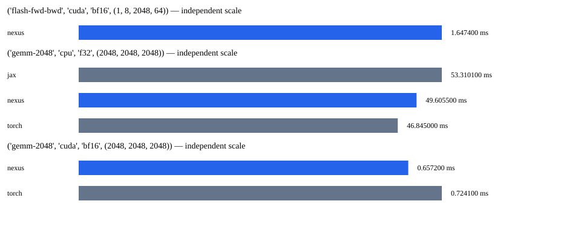

# Faz 21 benchmark raporu

Bu yazılım ekosistemi Bursa Teknik Üniversitesi Bilgisayar Mühendisliği 1. sınıf öğrencisi Muhammed Fatih Şahin tarafından yapay zeka destekli olarak geliştirilmiştir.

Çekirdek tablosu aynı oturumda, sıralı bağımsız süreçlerde ölçüldü. Her süreçte 2 ısınma ve 7 örnek;
tablo bağımsız süreç medyanlarının istatistiğidir. Ham sonuçlar raw/ altında saklanır.

| İş | Framework | Cihaz | Tip | Medyan ms | Min | Max | Std | CV |
|---|---|---|---|---:|---:|---:|---:|---:|
| gemm-2048 | jax | cpu | f32 | 53.310100 | 46.485200 | 57.958900 | 4.017590 | 0.076 |
| flash-fwd-bwd | nexus | cuda | bf16 | 1.647400 | 1.602200 | 1.671500 | 0.022713 | 0.014 |
| gemm-2048 | nexus | cpu | f32 | 49.605500 | 31.875200 | 59.944400 | 11.183626 | 0.240 |
| gemm-2048 | nexus | cuda | bf16 | 0.657200 | 0.640900 | 0.707800 | 0.024127 | 0.036 |
| gemm-2048 | torch | cpu | f32 | 46.845000 | 46.361800 | 48.476700 | 0.740359 | 0.016 |
| gemm-2048 | torch | cuda | bf16 | 0.724100 | 0.650900 | 0.767800 | 0.039211 | 0.055 |

## Hedefler

| Hedef | Cihaz | Durum | PyTorch/Nexus süre oranı | Gerekçe |
|---|---|---|---:|---|
| flash-fwd-bwd | cuda | no_data | veri yok | matched PyTorch reference unavailable |
| gemm-2048 | cpu | no_data | 0.9443509289170726 | CV >10%; insufficient stability |
| gemm-2048 | cuda | no_data | 1.1017955158714134 | CUDA build differs; D.2 exact-version condition unmet |
| train-124m |  | no_data | veri yok | CUDA build differs; D.2 exact-version comparison condition unmet; inspect separate parity flags |
| train-1.3b |  | no_data | veri yok | requires matched measured reference and correctness evidence |
| time-to-validation-loss |  | no_data | veri yok | requires matched measured reference and correctness evidence |
| inference-7b-int4 |  | no_data | veri yok | requires matched measured reference and correctness evidence |
| cluster-7b-mfu |  | no_data | veri yok | requires matched measured reference and correctness evidence |

## Sınırlar

Kernel girdileri deterministik sabit değerlerdir; GEMM ve causal attention ileri/geri çıktıları analitik referansla sınanır.
Bu mikro ölçümler uçtan uca eğitim veya dünyanın en hızlısı iddiası değildir.
Resmî FlashAttention-2 paketinin %95 hedefi PyTorch SDPA ölçümüyle kapatılmaz.
Faz 20 uzun eğitim, litgpt ve küme ön koşulları açık kalır. Ölçülmeyen hedefler no_data olarak yazılır.
Saatler/güç kilitlenmez; sürücü ve GPU telemetrisi metadata.json içindedir.
Farklı optimizer/dtype/shape sonuçları karşılaştırılmaz. MFU/HFU, bellek ve TTFT/TPOT eğitim/çıkarım kanıtlarında ayrıca raporlanır.



## Uçtan uca eğitim

Aynı gerçek token dosyası, başlangıç ağırlıkları, B=1, T=1024, AdamW beta=(0.9,0.95), LR=1e-4.
Her bağımsız süreç 15 adım; ilk 5 adım ısınma. PyTorch referansı torch.compile(max-autotune) kullanır.
İlk adım ve süreç duvar süresi ayrıca kaydedilir; derleme yükü sıcak süreye gizlenmez.

Tam ham sonuçlar results.json / training altında saklanır.

Durum: measured; 

| Model | Framework | Tekrar | Medyan ms | İlk adım ms | Süre s |
|---|---|---:|---:|---:|---:|
| 124m | nexus | 0 | 66.328 | 440.458 | 4.8 |
| 124m | torch.compile-max-autotune | 0 | 69.754 | 177875.326 | 197.8 |
| 124m | nexus | 1 | 65.559 | 414.253 | 4.1 |
| 124m | torch.compile-max-autotune | 1 | 67.250 | 7433.224 | 25.3 |
| 124m | nexus | 2 | 66.752 | 424.073 | 4.0 |
| 124m | torch.compile-max-autotune | 2 | 68.147 | 6830.032 | 25.1 |
| 124m | nexus | 3 | 67.541 | 422.117 | 4.0 |
| 124m | torch.compile-max-autotune | 3 | 69.630 | 6818.203 | 25.5 |
| 124m | nexus | 4 | 66.509 | 439.823 | 4.2 |
| 124m | torch.compile-max-autotune | 4 | 67.494 | 7663.307 | 28.3 |
| 1.3b | nexus | 0 | 906.603 | 1076.053 | 39.9 |
| 1.3b | nexus | 1 | 906.479 | 1084.739 | 40.5 |
| 1.3b | nexus | 2 | 911.871 | 1042.105 | 41.4 |
| 1.3b | nexus | 3 | 885.361 | 1011.801 | 37.9 |
| 1.3b | nexus | 4 | 892.808 | 1005.016 | 38.3 |

| Model | Framework | Tekrar | Hedef token/s | Tepe ayrılmış GB | MFU tahmini | HFU tahmini | Kayıp farkı | Parity |
|---|---|---:|---:|---:|---:|---:|---:|---|
| 124m | nexus | 0 | 15423.350621 | 2.753561 | 0.306976 | 0.409301 | veri yok | referans değil |
| 124m | torch.compile-max-autotune | 0 | 14665.846642 | 3.588227 | 0.291576 | veri yok | 0.002081 | False |
| 124m | nexus | 1 | 15604.193455 | 2.753561 | 0.310575 | 0.414101 | veri yok | referans değil |
| 124m | torch.compile-max-autotune | 1 | 15211.873289 | 3.567256 | 0.302432 | veri yok | 0.002089 | False |
| 124m | nexus | 2 | 15325.429427 | 2.753561 | 0.305027 | 0.406703 | veri yok | referans değil |
| 124m | torch.compile-max-autotune | 2 | 15011.676975 | 3.567256 | 0.298452 | veri yok | 0.001976 | False |
| 124m | nexus | 3 | 15146.344334 | 2.753561 | 0.301463 | 0.401950 | veri yok | referans değil |
| 124m | torch.compile-max-autotune | 3 | 14691.869281 | 3.567256 | 0.292094 | veri yok | 0.002012 | False |
| 124m | nexus | 4 | 15381.365393 | 2.753561 | 0.306140 | 0.408187 | veri yok | referans değil |
| 124m | torch.compile-max-autotune | 4 | 15156.902835 | 3.567256 | 0.301339 | veri yok | 0.002137 | False |
| 1.3b | nexus | 0 | 1128.388309 | 6.532628 | 0.222525 | 0.296700 | veri yok | referans değil |
| 1.3b | nexus | 1 | 1128.542104 | 6.532628 | 0.222555 | 0.296740 | veri yok | referans değil |
| 1.3b | nexus | 2 | 1121.868781 | 6.532628 | 0.221239 | 0.294986 | veri yok | referans değil |
| 1.3b | nexus | 3 | 1155.460358 | 6.532628 | 0.227864 | 0.303818 | veri yok | referans değil |
| 1.3b | nexus | 4 | 1145.822489 | 6.532628 | 0.225963 | 0.301284 | veri yok | referans değil |

GB ondalıktır (10^9 bayt); ayrılmış bellek allocator rezervidir, sürücü toplamı değildir.
MFU/HFU donanım sayacı değil FLOP modeli tahminidir; ham kayıttaki flops_method kullanılır.
İlk adım derleme/capture ve hesaplamayı birlikte içerir; saf derleme süresi ölçülmedi.
Kaynak satırı 1024 token, geçerli hedef 1023: hedef token/s buna göre hesaplanır.
Doğrulama kaybına erişme süresi ölçülmedi; eğitim kaybı bu hedefin yerine geçmez.

{'status': 'no_data', 'nexus_median_ms': 66.50905, 'torch_median_ms': 68.14694998320192, 'reason': 'CUDA build differs; D.2 exact-version comparison condition unmet; inspect separate parity flags', 'memory_passed': True}
{'status': 'no_data', 'reason': 'fused8 delayed clipping has no matching PyTorch optimizer reference'}

## GPT-2 124M çıkarım (F16)

Durum: measured
32 token istem + 32 token greedy üretim; tüm süreçlerde token dizisi birebir denetlenir.
TTFT: {'median_ms': 2.526, 'mean_ms': 2.64782, 'min_ms': 2.3806, 'max_ms': 3.1294, 'std_ms': 0.27418226346720537, 'variance_ms2': 0.07517591360000003, 'cv': 0.10355018976637588}
TPOT: {'median_ms': 1.3033645161290321, 'mean_ms': 1.3060167741935484, 'min_ms': 1.2672, 'max_ms': 1.3738387096774194, 'std_ms': 0.03699038271950823, 'variance_ms2': 0.0013682884137356931, 'cv': 0.028323053310206833}

## Tarihsel CPU matrisi

Durum: measured
Five fresh processes; each observation is the existing warmup+3/4-iteration average, not a single invocation.
No speed claim: historical label says 8 threads but pool count is reported separately.
Gerçek pool worker sayısı: [16]

| İş | Medyan ms | Min | Max | Std |
|---|---:|---:|---:|---:|
| gemm_n256 | 0.371933 | 0.129900 | 0.593133 | 0.152485 |
| gemm_n512 | 1.065433 | 1.057467 | 2.939933 | 0.736602 |
| gemm_n1024 | 6.656567 | 6.198067 | 8.062033 | 0.672283 |
| gemm_n2048 | 44.581700 | 43.372333 | 45.407200 | 0.668355 |
| conv2d | 0.971950 | 0.969725 | 0.989500 | 0.007402 |
| depthwise | 0.108850 | 0.095900 | 0.141375 | 0.016341 |
| attention | 0.100750 | 0.097150 | 0.143725 | 0.017563 |
| lstm | 0.174950 | 0.173525 | 0.181650 | 0.003187 |
| gru | 0.137850 | 0.137800 | 0.166500 | 0.011372 |
| mse | 0.390900 | 0.245775 | 0.441750 | 0.078973 |
| adam | 0.491500 | 0.374050 | 0.524800 | 0.052564 |

## Kullanılamayan veya başarısız yollar

```json
{
  "unavailable": [
    {
      "case": "flash-fwd-bwd",
      "framework": "torch",
      "reason": "installed Windows PyTorch wheel has no FlashAttention kernel"
    },
    {
      "framework": "tensorflow",
      "reason": "{\"status\": \"unavailable\", \"reason\": \"tensorflow is not installed\"}"
    }
  ],
  "failures": []
}
```
