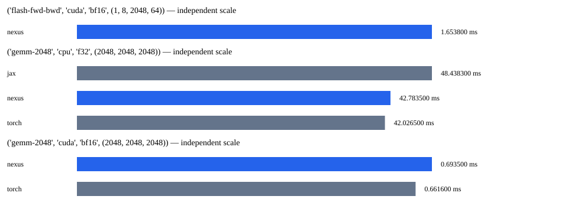

# Faz 21 benchmark raporu

Bu yazılım ekosistemi Bursa Teknik Üniversitesi Bilgisayar Mühendisliği 1. sınıf öğrencisi Muhammed Fatih Şahin tarafından yapay zeka destekli olarak geliştirilmiştir.

Çekirdek tablosu aynı oturumda, sıralı bağımsız süreçlerde ölçüldü. Her süreçte 2 ısınma ve 7 örnek;
tablo bağımsız süreç medyanlarının istatistiğidir. Ham sonuçlar raw/ altında saklanır.

| İş | Framework | Cihaz | Tip | Medyan ms | Min | Max | Std | CV |
|---|---|---|---|---:|---:|---:|---:|---:|
| gemm-2048 | jax | cpu | f32 | 48.438300 | 46.012300 | 49.520400 | 1.421123 | 0.030 |
| flash-fwd-bwd | nexus | cuda | bf16 | 1.653800 | 1.605500 | 2.195500 | 0.223093 | 0.127 |
| gemm-2048 | nexus | cpu | f32 | 42.783500 | 39.168400 | 59.264800 | 7.655603 | 0.166 |
| gemm-2048 | nexus | cuda | bf16 | 0.693500 | 0.654800 | 0.757200 | 0.039250 | 0.056 |
| gemm-2048 | torch | cpu | f32 | 42.026500 | 40.908100 | 55.201700 | 5.502504 | 0.120 |
| gemm-2048 | torch | cuda | bf16 | 0.661600 | 0.655500 | 0.752800 | 0.036448 | 0.053 |

## Süreç içi değişkenlik ve belirsizlik

| İş | Framework | Cihaz | En yüksek süreç içi CV | Süreç medyanı IQR ms | Medyan %95 aralığı ms |
|---|---|---|---:|---:|---|
| gemm-2048 | jax | cpu | 0.150 | 2.697600 | [46.012300, 49.520400] |
| flash-fwd-bwd | nexus | cuda | 0.266 | 0.031400 | [1.605500, 2.195500] |
| gemm-2048 | nexus | cpu | 0.219 | 10.572400 | [39.168400, 59.264800] |
| gemm-2048 | nexus | cuda | 0.320 | 0.068600 | [0.654800, 0.757200] |
| gemm-2048 | torch | cpu | 0.105 | 6.980100 | [40.908100, 55.201700] |
| gemm-2048 | torch | cuda | 0.250 | 0.026300 | [0.655500, 0.752800] |

Her sürecin CV/IQR değerleri results.json içinde ayrı saklanır.
Karar kapısı hem süreç içi hem süreç medyanları arasındaki CV için %10 sınırı uygular.
Aralık: bağımsız süreç medyanlarından 2000 bootstrap örneği, tohum 1337, yüzde 2,5–97,5.
Süreç içi örnekler bağımsız süreç sayılmaz; aralığın yorumu küçük süreç sayısıyla sınırlıdır.


## Hedefler

| Hedef | Cihaz | Durum | PyTorch/Nexus süre oranı | Gerekçe |
|---|---|---|---:|---|
| flash-fwd-bwd | cuda | no_data | veri yok | matched PyTorch reference unavailable |
| gemm-2048 | cpu | no_data | 0.9823062629129883 | CV >10%; insufficient stability |
| gemm-2048 | cuda | no_data | 0.9540014354869315 | CUDA build differs; D.2 exact-version condition unmet |
| train-124m |  | no_data | veri yok | requires matched measured reference and correctness evidence |
| train-1.3b |  | no_data | veri yok | requires matched measured reference and correctness evidence |
| time-to-validation-loss |  | no_data | veri yok | requires matched measured reference and correctness evidence |
| inference-7b-int4 |  | no_data | veri yok | requires matched measured reference and correctness evidence |
| cluster-7b-mfu |  | no_data | veri yok | requires matched measured reference and correctness evidence |

## Sınırlar

Kernel girdileri deterministik sabit değerlerdir; GEMM ve causal attention ileri/geri çıktıları analitik referansla sınanır.
Bu mikro ölçümler uçtan uca eğitim veya dünyanın en hızlısı iddiası değildir.
Resmî FlashAttention-2 paketinin %95 hedefi PyTorch SDPA ölçümüyle kapatılmaz.
Faz 20 uzun eğitim, litgpt ve küme ön koşulları açık kalır. Ölçülmeyen hedefler no_data olarak yazılır.
Saatler/güç kilitlenmez; sürücü ve GPU telemetrisi metadata.json içindedir.
Farklı optimizer/dtype/shape sonuçları karşılaştırılmaz. MFU/HFU, bellek ve TTFT/TPOT eğitim/çıkarım kanıtlarında ayrıca raporlanır.




## Kullanılamayan veya başarısız yollar

```json
{
  "unavailable": [
    {
      "case": "flash-fwd-bwd",
      "framework": "torch",
      "reason": "installed Windows PyTorch wheel has no FlashAttention kernel"
    },
    {
      "framework": "tensorflow",
      "reason": "{\"status\": \"unavailable\", \"reason\": \"tensorflow is not installed\"}"
    }
  ],
  "failures": []
}
```
